# 🍅 Tomato Plant Disease Classification & Decision Support System

[](https://www.python.org/)
[](https://www.tensorflow.org/)
[](https://fastapi.tiangolo.com/)
[](https://streamlit.io/)
[](https://www.docker.com/)
[](LICENSE)
[](tomato_cnn_outputs/validation_metrics.json)
[](tomato_cnn_outputs/validation_metrics.json)

An end-to-end deep learning system and educational research platform designed for automated visual diagnosis and agronomic decision support across **10 tomato leaf conditions** (9 pathological infections and 1 healthy state). 

This project unites **applied computer vision theory**, an **optimized custom Convolutional Neural Network (CNN)**, a production-grade **FastAPI microservice**, an interactive **Streamlit agricultural dashboard**, and complete **Docker multi-container orchestration**.

---

## 📌 Table of Contents

1. [Key Highlights](#-key-highlights)
2. [Project Context & Precision Agriculture Motivation](#-project-context--precision-agriculture-motivation)
   - [Global Food Security & Economic Importance of Tomatoes](#global-food-security--economic-importance-of-tomatoes)
   - [The Phytosanitary Burden in Solanaceous Crops](#the-phytosanitary-burden-in-solanaceous-crops)
   - [The Scouting Bottleneck & Diagnostic Ambiguity](#the-scouting-bottleneck--diagnostic-ambiguity)
   - [Project Vision & Core Engineering Principles](#project-vision--core-engineering-principles)
3. [Understanding Convolutional Neural Networks (CNNs)](#-understanding-convolutional-neural-networks-cnns)
   - [Deep Learning & Computer Vision Foundations](#deep-learning--computer-vision-foundations)
   - [Why CNNs Excel Over Traditional Machine Learning](#why-cnns-excel-over-traditional-machine-learning)
   - [Visual Hierarchy of Learned Representations](#visual-hierarchy-of-learned-representations)
   - [General CNN Architecture Visual Overview](#general-cnn-architecture-visual-overview)
4. [CNN Architecture: From Input Image to Prediction](#-cnn-architecture-from-input-image-to-prediction)
   - [Step 1 — Image Input Tensor](#step-1--image-input-tensor)
   - [Step 2 — Image Preprocessing & Normalization](#step-2--image-preprocessing--normalization)
   - [Step 3 — Data Augmentation Strategy](#step-3--data-augmentation-strategy)
   - [Step 4 — 2D Convolution Operation](#step-4--2d-convolution-operation)
   - [Step 5 — Non-Linear Activation (ReLU)](#step-5--non-linear-activation-relu)
   - [Step 6 — Spatial Pooling (MaxPooling2D)](#step-6--spatial-pooling-maxpooling2d)
   - [Step 7 — Deep Hierarchical Feature Extraction](#step-7--deep-hierarchical-feature-extraction)
   - [Step 8 — Global Average Pooling (GAP) vs. Flattening](#step-8--global-average-pooling-gap-vs-flattening)
   - [Step 9 — Fully Connected Dense Representation](#step-9--fully-connected-dense-representation)
   - [Step 10 — Regularization via Dropout](#step-10--regularization-via-dropout)
   - [Step 11 — Softmax Probability Distribution](#step-11--softmax-probability-distribution)
   - [Step 12 — Final Prediction & Agronomic Mapping](#step-12--final-prediction--agronomic-mapping)
5. [Project-Specific CNN Architecture & Tensor Progression](#-project-specific-cnn-architecture--tensor-progression)
   - [Exact Layer Specification Table](#exact-layer-specification-table)
   - [Tensor Shape Progression & Mathematical Verification](#tensor-shape-progression--mathematical-verification)
   - [Project Pipeline Flowchart](#project-pipeline-flowchart)
6. [How CNN Training Works](#-how-cnn-training-works)
   - [End-to-End Training Lifecycle](#end-to-end-training-lifecycle)
   - [Loss Formulation: Sparse Categorical Cross-Entropy](#loss-formulation-sparse-categorical-cross-entropy)
   - [Optimization with Adam & Learning Rate Scheduling](#optimization-with-adam--learning-rate-scheduling)
   - [Training Loop Execution Flowchart](#training-loop-execution-flowchart)
7. [Model Evaluation & Research Benchmarks](#-model-evaluation--research-benchmarks)
   - [Dataset Distribution & Splits](#dataset-distribution--splits)
   - [Per-Class Validation Performance (Classification Report)](#per-class-validation-performance-classification-report)
   - [Confusion Matrix & Error Analysis](#confusion-matrix--error-analysis)
   - [Diagnostic Trade-Offs: False Positives vs. False Negatives](#diagnostic-trade-offs-false-positives-vs-false-negatives)
   - [Evaluation Pipeline Flowchart](#evaluation-pipeline-flowchart)
8. [Understanding CNN Predictions with Grad-CAM](#-understanding-cnn-predictions-with-grad-cam)
   - [The Black-Box Challenge in Plant Pathology](#the-black-box-challenge-in-plant-pathology)
   - [Mathematical Formulation of Grad-CAM](#mathematical-formulation-of-grad-cam)
   - [Visualizing Model Attention on Tomato Leaves](#visualizing-model-attention-on-tomato-leaves)
   - [Grad-CAM Computation Flowchart](#grad-cam-computation-flowchart)
9. [End-to-End System Workflows](#-end-to-end-system-workflows)
   - [Workflow A: Research & Model Development](#workflow-a-research--model-development)
   - [Workflow B: Production Inference & Decision Support](#workflow-b-production-inference--decision-support)
   - [Full System Architecture Diagram](#full-system-architecture-diagram)
10. [CNN Technical Concepts Reference Guide](#-cnn-technical-concepts-reference-guide)
11. [Training vs. Inference Comparison](#-training-vs-inference-comparison)
12. [Supported Tomato Leaf Disease Classes & Agronomic Pathology Guide](#-supported-tomato-leaf-disease-classes--agronomic-pathology-guide)
    - [Summary Overview Table](#summary-overview-table)
    - [In-Depth Pathological Profiles (Classes 0-9)](#in-depth-pathological-profiles-classes-0-9)
    - [Comparative Differential Diagnosis Matrix](#comparative-differential-diagnosis-matrix)
13. [Quick Start: Docker (Recommended)](#-quick-start-docker-recommended)
14. [Local Installation & Setup](#-local-installation--setup)
15. [Running the Services](#-running-the-services)
    - [1. FastAPI REST Backend](#1-fastapi-rest-backend)
    - [2. Streamlit Web Dashboard](#2-streamlit-web-dashboard)
    - [3. Jupyter Research Notebooks](#3-jupyter-research-notebooks)
16. [REST API Documentation & Endpoints](#-rest-api-documentation--endpoints)
17. [Automated Testing & Quality Assurance](#-automated-testing--quality-assurance)
18. [Limitations & Research Considerations](#-limitations--research-considerations)
19. [Future Research Directions](#-future-research-directions)
20. [Agricultural Disclaimer](#-agricultural-disclaimer)
21. [License & Attribution](#-license--attribution)

---

## 🌟 Key Highlights

- **94.57% Validation Accuracy**: Verified against 4,585 held-out validation images across 10 balanced classes with a validation loss of **0.1637**.
- **CPU-Optimized Architecture**: Designed with a lightweight $160 \times 160$ spatial input and Global Average Pooling, totaling just **333,152 parameters** (111,050 trainable / 434 KB memory footprint), enabling sub-40 ms inference on commodity CPUs without GPU dependency.
- **Explainable AI (Grad-CAM)**: Built-in Gradient-weighted Class Activation Mapping targeting the final convolutional layer (`last_conv`) to visually audit the spatial attention of the neural network.
- **Enterprise-Grade Microservice**: High-throughput FastAPI REST API with automatic OpenAPI/Swagger documentation, Pydantic v2 data validation, CORS middleware, and container health probes.
- **Interactive Agronomic UI**: Streamlit web dashboard presenting real-time leaf segmentation previews, confidence probability distributions, symptom profiles, and downloadable diagnostic PDF/CSV reports.
- **Full Docker Orchestration**: Production-ready multi-container architecture orchestrated via Docker Compose uniting backend and frontend services.

---

## 🌾 Project Context & Precision Agriculture Motivation

### Global Food Security & Economic Importance of Tomatoes
The cultivated tomato (*Solanum lycopersicum*) is among the most extensively produced and economically vital horticultural crops on Earth. According to the Food and Agriculture Organization (FAO), global tomato production exceeds **180 million metric tonnes annually**, cultivated across more than **5 million hectares** spanning open-field farms and climate-controlled greenhouses.

Beyond its widespread culinary ubiquity, the tomato represents:
- **A Vital Smallholder Cash Crop**: For millions of smallholder farming families across Asia, Africa, and the Americas, tomato cultivation provides high-return cash flow, seasonal rural employment, and poverty alleviation.
- **Essential Nutritional Security**: Tomatoes provide a rich dietary source of essential micronutrients, particularly **Vitamin C (ascorbic acid)**, **Vitamin A (beta-carotene)**, **folate**, and **potassium**. Crucially, they are the primary dietary source of **lycopene**—a powerful carotenoid antioxidant linked in biomedical studies to reduced risks of cardiovascular disease and certain cancers.

### The Phytosanitary Burden in Solanaceous Crops
Despite high agronomic value, the tomato plant possesses delicate vegetative tissue, a dense foliage canopy, and soft fruit, rendering it exceptionally vulnerable to a broad spectrum of phytopathogens. Foliar diseases caused by bacteria, fungi, oomycetes, viruses, and parasitic arthropods frequently result in **yield losses ranging from 20% to complete 100% total crop failure** in untreated or mismanaged fields.

Major factors driving disease virulence include:
- **Microclimate Vulnerability**: High ambient humidity ($>80\%$), continuous overhead leaf moisture, and warm temperatures ($20^\circ\text{C}-30^\circ\text{C}$) create ideal incubation chambers for rapid spore germination and bacterial proliferation.
- **Explosive Reproductive Cycles**: Pathogens like *Phytophthora infestans* (Late Blight) and *Tetranychus urticae* (Two-Spotted Spider Mites) reproduce exponentially. A minor localized infection can engulf an entire hectare within 5 to 7 days.
- **Vector-Borne Epidemics**: Viruses such as *Tomato Yellow Leaf Curl Virus* (TYLCV) are vectored aggressively by Silverleaf Whiteflies, allowing rapid viral dissemination across entire regional agricultural belts.

### The Scouting Bottleneck & Diagnostic Ambiguity
Traditional disease surveillance relies almost entirely on manual visual scouting by farmers, agricultural extension workers, or certified plant pathologists. However, this conventional approach faces severe operational limitations:
1. **Critical Extension Agent Scarcity**: In developing and rural farming communities, the ratio of public agricultural extension officers to active farmers frequently exceeds 1:3,000. Agronomists cannot visit every smallholder field during critical early-infection windows.
2. **Visual Lookalike Ambiguity**: Early-stage foliar infections present nearly indistinguishable symptoms to the naked eye. For instance:
   - Early lesions of *Bacterial Spot* closely mimic early lesions of *Septoria Leaf Spot*.
   - Concentric target rings of *Early Blight* overlap visually with *Target Spot*.
   - Nascent *Two-Spotted Spider Mite* feeding punctures (chlorotic stippling) are easily mistaken for bacterial grease specks or nutrient chlorosis.
3. **Severe Consequences of Misdiagnosis**:
   - Applying synthetic fungicides for a bacterial or viral infection wastes capital, leaves the pathogen unchecked, and contaminates local watersheds.
   - Excessive or misdirected chemical spraying accelerates **chemical resistance** (such as copper-tolerant *Xanthomonas* or strobilurin-resistant *Corynespora* strains).
   - In late blight outbreaks, delayed diagnosis by even 48 hours eliminates the window for protective intervention, necessitating total crop destruction.

### Project Vision & Core Engineering Principles
This project was initiated to bridge the gap between advanced deep learning research and practical, frontline agricultural operations. The system was designed around four core engineering requirements:

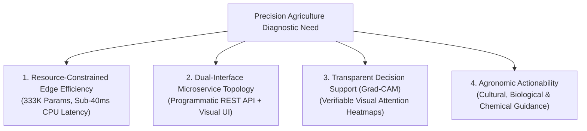

1. **Resource-Constrained Efficiency**: Unlike massive multi-gigabyte foundation models requiring expensive cloud GPU infrastructure ($15,000+ accelerators), this system employs an optimized custom architecture requiring just **333,152 parameters** (434 KB memory footprint) operating at $160 \times 160$ resolution. It delivers sub-40 ms inference on commodity x86 and ARM processors, opening doors for low-cost edge deployments (Raspberry Pi, low-spec cloud VMs, field tablets).
2. **Dual-Interface Microservice Ecosystem**:
   - A high-concurrency **FastAPI REST API** with standard OpenAPI schemas, enabling seamless integration into automated agricultural drones, smart greenhouse IoT controllers, and mobile apps.
   - An intuitive **Streamlit Web Dashboard** enabling agronomists, extension officers, and farmers to drag-and-drop photos, inspect class probabilities, and download PDF/CSV management plans without writing a single line of code.
3. **Transparent Decision Support (Grad-CAM)**: Agricultural AI must be trusted by domain specialists. By integrating Gradient-weighted Class Activation Mapping directly into the diagnostic pipeline, users can visually verify whether the model is focusing on the actual necrotic lesion or being misled by background soil or camera artifacts.
4. **Actionable Integrated Pest Management (IPM)**: Predicting a class label (e.g., `Tomato___Early_blight`) is only half the battle. This system enriches every inference response with verified pathogen biology, incubation conditions, cultural sanitation practices, biological alternatives, and targeted chemical active ingredients.

---

## 🧠 Understanding Convolutional Neural Networks (CNNs)

### Deep Learning & Computer Vision Foundations

**Computer Vision (CV)** is the branch of computer science and artificial intelligence dedicated to enabling machines to extract, process, analyze, and comprehend structured visual data such as digital images and videos.

**Deep Learning (DL)** is a subset of machine learning based on artificial neural networks with multiple processing layers. Unlike classical statistical algorithms that process tabular attributes, deep learning models learn representational hierarchies directly from unstructured data (raw pixels, audio waveforms, or natural language tokens).

A **Convolutional Neural Network (CNN)** is a specialized deep neural network architecture designed explicitly for grid-structured topological data, such as 2D digital images. The fundamental power of CNNs stems from three core architectural principles:
1. **Local Receptive Fields**: Neurons in convolutional layers connect only to a localized subregion of the input image rather than to every input pixel, mirroring the biological visual cortex.
2. **Shared Weights (Translation Invariance)**: The same learnable filter/kernel slides across the entire visual field. If a visual pattern (such as an early blight necrotic lesion) appears in the top-left or bottom-right corner of a leaf, the same kernel detects it regardless of its spatial location.
3. **Spatial Hierarchy**: Stacking multiple convolutional and pooling stages enables the network to build a hierarchical representation of visual features—from primitive gradients to high-level disease pathology.

---

### Why CNNs Excel Over Traditional Machine Learning

Before CNNs, computer vision relied on **classical machine learning pipelines** requiring manual, hand-engineered feature extractors:

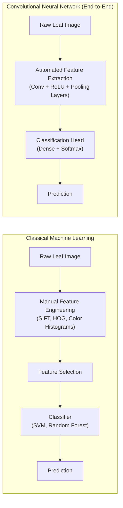

| Dimension | Traditional Machine Learning (SVM, Random Forest) | Convolutional Neural Networks (CNN) |
|---|---|---|
| **Feature Extraction** | Handcrafted manually by domain experts (e.g., SIFT, Haralick texture, edge histograms). | **Automated & Learned**: Kernels adapt their numerical weights through backpropagation. |
| **Spatial Awareness** | Flattens images into 1D vectors, destroying 2D spatial relationships and pixel neighbor correlations. | **Preserves 2D Spatial Structure**: Convolutions operate over localized 2D windows $(k_h \times k_w)$. |
| **Translation Invariance** | Low. Moving a lesion by 20 pixels alters the entire flattened vector representation. | **High**: Weight sharing and pooling guarantee feature detection irrespective of spatial shifts. |
| **Scalability** | Struggles with high-dimensional image inputs ($160 \times 160 \times 3 = 76,800$ inputs explode parameter count in dense networks). | Highly parameter-efficient due to kernel weight sharing. |
| **Domain Portability** | Features hand-crafted for tomato leaves may fail on other crops without redesigning extractors. | Architecture generalizes across image domains by learning relevant filters directly from data. |

---

### Visual Hierarchy of Learned Representations

A trained CNN does not perceive an entire leaf at once. Instead, visual comprehension emerges layer by layer:

| CNN Processing Stage | Features Learned (Conceptual Hierarchy) | Concrete Example in Tomato Leaf Disease Detection |
|---|---|---|
| **Early Convolution Layers** (`conv_block_1`) | Low-level geometric primitives: edge orientations, line boundaries, high-contrast borders, raw color gradients. | Distinguishing green leaf margins against white/dark backgrounds; detecting sharp edges of fresh lesions. |
| **Intermediate Layers** (`conv_block_2`) | Mid-level textures, recurring motifs, curves, concentric rings, surface roughness. | Identifying concentric target rings (*Alternaria solani*), yellow chlorotic halos, and olive-green velvety molds. |
| **Deep Convolution Layers** (`last_conv`) | High-level, semantically rich visual structures and complex disease morphology. | Discriminating between irregular water-soaked spots (*Xanthomonas*), spider mite webbing stipples, and systemic virus leaf curling. |
| **Classification Head** (`Dense` + `Softmax`) | Global class boundaries and probabilistic decision surfaces. | Mapping global visual feature vectors into confidence scores across the 10 target disease categories. |

> [!NOTE]
> *Scientific Caveat*: In deep learning literature, feature visualization techniques (such as filter activation maximization) show that early and intermediate layers behave similarly to Gabor filters and texture detectors. However, individual artificial neurons operate collectively; the table above represents a conceptual hierarchy rather than proof that a single isolated neuron is exclusively assigned to a single symptom.

---

### General CNN Architecture Visual Overview

The following diagram illustrates how an image moves through convolutional feature extraction into dense classification:

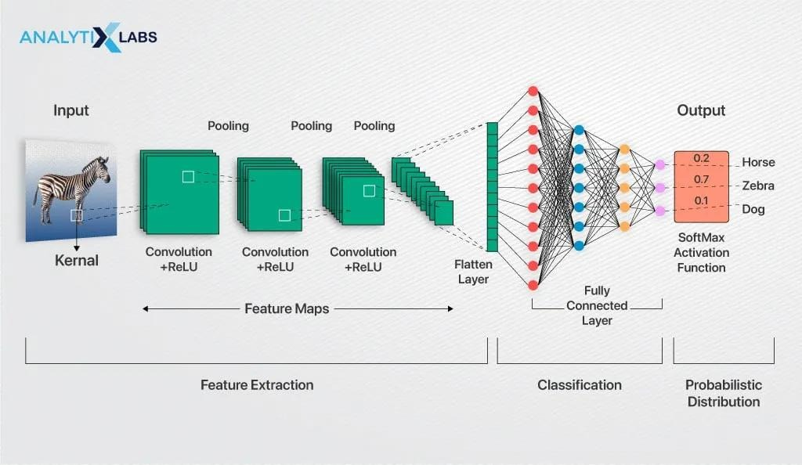

---

## 🔬 CNN Architecture: From Input Image to Prediction

Every image classification inference passes through **12 consecutive algorithmic steps**. Below is the mathematical and conceptual breakdown of each stage as implemented in this project:

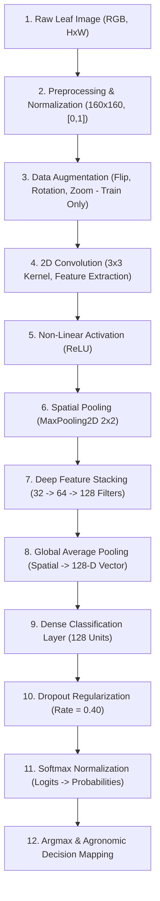

---

### Step 1 — Image Input Tensor

Digital color photographs are discrete 3D numerical tensors:

$$\mathbf{X} \in \mathbb{R}^{H \times W \times C}$$

Where:
- **$H = 160$**: Image height in pixels.
- **$W = 160$**: Image width in pixels.
- **$C = 3$**: Color channels corresponding to **Red**, **Green**, and **Blue** (RGB).
- **Pixel Values**: Raw integer intensities ranging from $0$ (zero intensity) to $255$ (maximum intensity).

A single input leaf image represents $160 \times 160 \times 3 = 76,800$ discrete numerical measurements. When processed by deep learning frameworks, an additional leading dimension is prepended representing the **batch size** $B$, yielding a 4D tensor shape $(B, 160, 160, 3)$.

---

### Step 2 — Image Preprocessing & Normalization

To ensure fast numerical convergence during gradient descent and stability during matrix multiplication, raw images undergo preprocessing:

1. **Spatial Resizing**: Bilinear interpolation resamples arbitrary camera resolutions (e.g., $3000 \times 4000$ smartphone photos) to the uniform $160 \times 160$ model canvas.
2. **Color Space Standardization**: Grayscale or 4-channel RGBA images are converted to canonical 3-channel RGB.
3. **Internal Normalization (`Rescaling`)**:
   In this project, pixel rescaling is embedded directly inside the model graph via the `layers.Rescaling(scale=1./255)` layer. This maps raw integer pixel intensities $x \in [0, 255]$ into floating-point values $\tilde{x} \in [0.0, 1.0]$:

   $$\tilde{x} = \frac{x}{255.0}$$

   *Implementation Advantage*: Embedding normalization inside the saved model graph prevents **training-serving skew**, ensuring that external API clients and frontend UIs do not need to manually divide pixel arrays before invoking predictions.

---

### Step 3 — Data Augmentation Strategy

To prevent the neural network from memorizing training samples (overfitting), stochastic data augmentation is applied during training:


- **Random Horizontal Flip (`RandomFlip("horizontal")`)**: Plants in agricultural fields exhibit left-right symmetry; flipping a leaf does not alter its pathological diagnosis.
- **Random Rotation (`RandomRotation(factor=(-0.1, 0.1))`)**: Rotates the image randomly within $[-36^\circ, +36^\circ]$ with reflect padding, simulating varying camera angles held by farmers.
- **Random Zoom (`RandomZoom(height_factor=0.1)`)**: Adjusts scale by up to $\pm 10\%$, simulating varying camera-to-leaf distances.

> [!IMPORTANT]
> Data augmentation layers in Keras are **active only during training** (`training=True`). During validation, testing, and production inference (`training=False`), these layers act as transparent identity passthroughs, guaranteeing deterministic evaluation.

---

### Step 4 — 2D Convolution Operation

The 2D convolution layer is the primary computational engine of the network. A small learnable matrix of weights called a **kernel** (or filter) slides across the input tensor:

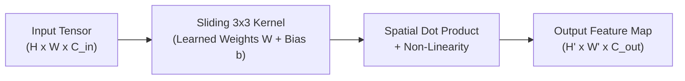

#### Mathematical Formulation

For an input feature map $X$ and a kernel $K$ of spatial dimensions $k_h \times k_w$ with bias $b$, the value at coordinate $(i, j)$ of the output feature map $Y$ is:

$$Y(i,j) = \sum_{m=-k_h/2}^{k_h/2} \sum_{n=-k_w/2}^{k_w/2} \sum_{c=1}^{C_{in}} X(i+m, j+n, c) \cdot K(m, n, c) + b$$

#### Concrete Numerical Example (3×3 Kernel)

Consider a single-channel $3 \times 3$ patch of an image convolved with a horizontal edge-detection kernel:

$$\text{Image Patch } X = \begin{bmatrix} 10 & 10 & 10 \\ 50 & 50 & 50 \\ 90 & 90 & 90 \end{bmatrix}, \quad \text{Kernel } K = \begin{bmatrix} -1 & -1 & -1 \\ 0 & 0 & 0 \\ 1 & 1 & 1 \end{bmatrix}, \quad \text{Bias } b = 0$$

$$\begin{aligned}
Y(1,1) &= (10 \times -1) + (10 \times -1) + (10 \times -1) \\
       &\quad + (50 \times 0) + (50 \times 0) + (50 \times 0) \\
       &\quad + (90 \times 1) + (90 \times 1) + (90 \times 1) + 0 \\
       &= -30 + 0 + 270 = \mathbf{240}
\end{aligned}$$

The large positive output ($240$) confirms that this kernel strongly fires when encountering a horizontal gradient transition (such as a lesion boundary).

In this project:
- **Kernel Size**: $3 \times 3$ across all convolutional stages.
- **Stride**: $(1, 1)$, advancing pixel by pixel.
- **Padding**: `"same"` padding (zero-padding the perimeter so that output spatial dimensions equal input spatial dimensions before pooling).

---

### Step 5 — Non-Linear Activation (ReLU)

Linear matrix operations alone can only model linear relationships. To enable the network to learn complex non-linear disease boundaries, every convolution is followed by the **Rectified Linear Unit (ReLU)** activation function:

$$f(z) = \max(0, z)$$

```
     f(z) ^
          |          / (Slope = 1)
          |         /
          |        /
          |       /
  --------+------/--------> z
          |0
```

- **Sparsity**: Negative responses (irrelevant background or unmatching patterns) are zeroed out, creating sparse, efficient representations.
- **Vanishing Gradient Prevention**: For all positive activations ($z > 0$), the derivative is constant: $\frac{df}{dz} = 1$. This allows error gradients to backpropagate deeply without decaying exponentially, unlike sigmoid or tanh activations.

---

### Step 6 — Spatial Pooling (MaxPooling2D)

Following convolution, **Max Pooling** downsamples spatial dimensions while preserving the most salient activations:

$$\tilde{Y}(i,j) = \max_{(m,n) \in \Omega(i,j)} X(m,n)$$

#### Concrete 2×2 Max-Pooling Example:

$$\begin{bmatrix} 12 & 20 & 30 & 0 \\ 8 & \mathbf{85} & 2 & 14 \\ 34 & 16 & 9 & 4 \\ 11 & 5 & \mathbf{72} & 18 \end{bmatrix} \xrightarrow{\text{2×2 Max-Pool, Stride=2}} \begin{bmatrix} \mathbf{85} & 30 \\ 34 & \mathbf{72} \end{bmatrix}$$

**Why Max Pooling is Essential**:
1. **Dimensionality Reduction**: Reduces the spatial area by $75\%$ (from $H \times W$ to $\frac{H}{2} \times \frac{W}{2}$), cutting computational workload and memory consumption for subsequent layers.
2. **Translation Invariance**: If a diseased spot shifts slightly by $1$ pixel, the maximum activation within the $2 \times 2$ window remains unchanged.
3. **Receptive Field Expansion**: Subsequent kernels observe larger proportions of the original leaf image.

---

### Step 7 — Deep Hierarchical Feature Extraction

By stacking alternating blocks of Conv2D and MaxPooling2D, the model extracts progressively deeper visual semantics:


- **`conv_block_1` (32 filters)**: Captures leaf silhouettes, veins, and high-contrast color transitions.
- **`conv_block_2` (64 filters)**: Identifies circular spots, concentric ring patterns, and textural irregularities.
- **`last_conv` (128 filters)**: Synthesizes high-level pathological patterns unique to specific diseases (e.g., distinguishing yellow leaf curl virus deformation from mosaic mottling).

---

### Step 8 — Global Average Pooling (GAP) vs. Flattening

Traditionally, CNNs used a `Flatten` layer before dense classification. In modern architectures, **Global Average Pooling (GAP)** is superior:

$$\text{GAP}_c = \frac{1}{H \times W} \sum_{i=1}^{H} \sum_{j=1}^{W} X(i, j, c)$$

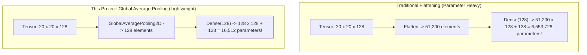

**Comparison**:
- **Flattening**: Produces a $51,200$-dimensional vector. Connecting this to $128$ dense neurons requires **6,553,728 weights**, making the model vulnerable to severe overfitting and inflating file size.
- **Global Average Pooling**: Computes the mean intensity of each feature map, producing a compact **128-dimensional vector**. Connecting this to the dense layer requires only **16,512 weights**—a **99.75% parameter reduction** that drastically improves generalization.

---

### Step 9 — Fully Connected Dense Representation

The 128-dimensional output from Global Average Pooling is passed to a fully connected dense layer (`classification_dense`):

$$\mathbf{z} = \text{ReLU}(\mathbf{W} \mathbf{x} + \mathbf{b})$$

Where $\mathbf{W} \in \mathbb{R}^{128 \times 128}$ and $\mathbf{b} \in \mathbb{R}^{128}$. This layer synthesizes non-linear interactions between the 128 high-level feature detectors to form a disease representation space.

---

### Step 10 — Regularization via Dropout

To prevent complex co-adaptations between dense units, **Dropout** with a rate of $p = 0.40$ ($40\%$) is applied immediately after the dense layer:

$$\tilde{h}_i = \begin{cases} 0 & \text{with probability } p = 0.40 \\ \frac{h_i}{1 - p} & \text{with probability } 1 - p = 0.60 \end{cases}$$

- **During Training**: At each training step, $40\%$ of the dense units are randomly zeroed out. The remaining activations are scaled by $\frac{1}{1 - p} \approx 1.667$ (inverted dropout) to preserve expectation. This forces every neuron to learn robust, independent features rather than relying on neighboring units.
- **During Inference**: Dropout is completely deactivated ($p = 0$). All 128 units are active, providing deterministic predictions.

---

### Step 11 — Softmax Probability Distribution

The final layer contains $10$ linear output units producing unnormalized log-odds (logits) $\mathbf{z} = [z_0, z_1, \dots, z_9]^T$. The **Softmax activation function** maps these real numbers into a valid probability distribution:

$$P(\text{class}_i \mid \mathbf{X}) = \frac{e^{z_i}}{\sum_{j=0}^{9} e^{z_j}}$$

Properties:
1. $\forall i: 0.0 < P(\text{class}_i) < 1.0$
2. $\sum_{i=0}^{9} P(\text{class}_i) = 1.0$

#### Illustrative Prediction Example:

| Index | Class Name | Logit ($z_i$) | Exponential ($e^{z_i}$) | Probability ($P$) | Formatted Confidence |
|:---:|:---|:---:|:---:|:---:|:---:|
| `0` | `Tomato___Bacterial_spot` | -1.20 | 0.3012 | 0.0016 | 0.16% |
| `1` | `Tomato___Early_blight` | **+5.10** | **164.0219** | **0.9023** | **90.23% (Top-1)** |
| `2` | `Tomato___Late_blight` | +1.80 | 6.0496 | 0.0333 | 3.33% |
| `3` | `Tomato___Leaf_Mold` | -0.50 | 0.6065 | 0.0033 | 0.33% |
| `4` | `Tomato___Septoria_leaf_spot` | +1.20 | 3.3201 | 0.0183 | 1.83% |
| `5` | `Tomato___Spider_mites...` | +0.40 | 1.4918 | 0.0082 | 0.82% |
| `6` | `Tomato___Target_Spot` | +1.10 | 3.0042 | 0.0165 | 1.65% |
| `7` | `Tomato___Tomato_Yellow_Leaf_Curl_Virus` | -1.80 | 0.1653 | 0.0009 | 0.09% |
| `8` | `Tomato___Tomato_mosaic_virus` | -2.10 | 0.1225 | 0.0007 | 0.07% |
| `9` | `Tomato___healthy` | +1.00 | 2.7183 | 0.0149 | 1.49% |
| **Sum** | — | — | **181.8014** | **1.0000** | **100.00%** |

> [!NOTE]
> *Softmax vs. Calibrated Empirical Confidence*: A softmax output score of $0.9023$ indicates that the model assigned $90.23\%$ relative probability to `Tomato___Early_blight` compared to the other 9 classes under the closed-world assumption. It should not be interpreted as an absolute frequentist probability that the leaf is definitively diseased.

---

### Step 12 — Final Prediction & Agronomic Mapping

The class with the highest probability is extracted via the $\arg\max$ operation:

$$\hat{y} = \arg\max_{i \in \{0, \dots, 9\}} P(\text{class}_i \mid \mathbf{X})$$

If $\hat{y} = 1$, the index is mapped via `class_mapping.json`:
- **Machine Class**: `Tomato___Early_blight`
- **Display Name**: Early Blight
- **Pathogen**: *Alternaria solani*
- **Target Recommendation**: Prune lower foliage and apply protective fungicides (copper or chlorothalonil).

Below is the visual schematic showing the full convolutional pipeline applied to leaf classification:

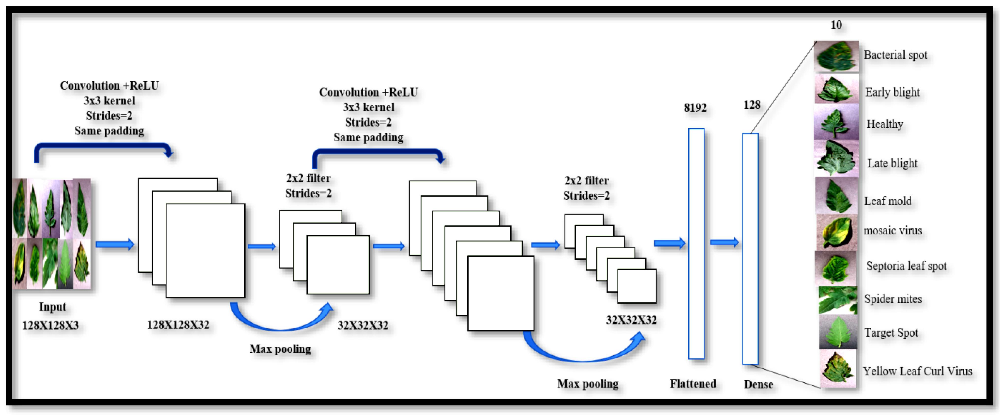

---

## 📐 Project-Specific CNN Architecture & Tensor Progression

### Exact Layer Specification Table

The following architecture was verified directly from the trained model file (`tomato_cnn_outputs/tomato_disease_cnn_final.keras`):

| # | Layer Name | Layer Type | Output Tensor Shape | Param # | Hyperparameters & Configuration | Agronomic / Processing Role |
|:---:|:---|:---|:---:|:---:|:---|:---|
| 0 | `input_image` | `InputLayer` | `(None, 160, 160, 3)` | 0 | `shape=(160, 160, 3)` | Accepts arbitrary batch of 3-channel RGB leaf images. |
| 1 | `data_augmentation` | `Sequential` | `(None, 160, 160, 3)` | 0 | `RandomFlip`, `RandomRotation(0.1)`, `RandomZoom(0.1)` | Invariant transformation during training; transparent during inference. |
| 2 | `normalization` | `Rescaling` | `(None, 160, 160, 3)` | 0 | `scale=1/255.0`, `offset=0.0` | Converts $[0, 255]$ integer pixels to $[0.0, 1.0]$ floats. |
| 3 | `conv_block_1` | `Conv2D` | `(None, 160, 160, 32)` | 896 | 32 filters, $3 \times 3$, stride 1, padding same, ReLU | Extracts low-level edges, leaf contours, and color gradients. |
| 4 | `pool_1` | `MaxPooling2D` | `(None, 80, 80, 32)` | 0 | $2 \times 2$ pool, stride 2, valid padding | Reduces spatial dimensions by 50%; introduces local shift tolerance. |
| 5 | `conv_block_2` | `Conv2D` | `(None, 80, 80, 64)` | 18,496 | 64 filters, $3 \times 3$, stride 1, padding same, ReLU | Detects mid-level textures, chlorotic halos, and spot shapes. |
| 6 | `pool_2` | `MaxPooling2D` | `(None, 40, 40, 64)` | 0 | $2 \times 2$ pool, stride 2, valid padding | Spatial downsampling to $40 \times 40$. |
| 7 | `last_conv` | `Conv2D` | `(None, 40, 40, 128)` | 73,856 | 128 filters, $3 \times 3$, stride 1, padding same, ReLU | High-level disease feature representation (Target layer for Grad-CAM). |
| 8 | `pool_3` | `MaxPooling2D` | `(None, 20, 20, 128)` | 0 | $2 \times 2$ pool, stride 2, valid padding | Spatial downsampling to $20 \times 20$. |
| 9 | `global_average_pooling` | `GlobalAveragePooling2D` | `(None, 128)` | 0 | Spatial average across $20 \times 20$ grid | Compresses each feature map to a single mean activation scalar. |
| 10 | `classification_dense` | `Dense` | `(None, 128)` | 16,512 | 128 units, ReLU activation | Non-linear feature combination and disease pattern correlation. |
| 11 | `dropout` | `Dropout` | `(None, 128)` | 0 | `rate=0.40` (training only) | Deactivates 40% of units to prevent co-adaptation. |
| 12 | `predictions` | `Dense` | `(None, 10)` | 1,290 | 10 units, Softmax activation | Projects 128 features onto 10 normalized class probabilities. |

- **Total Parameters**: 333,152 (1.27 MB)
- **Trainable Parameters**: 111,050 (433.79 KB)
- **Non-Trainable Parameters**: 0 (0.00 B)
- **Optimizer State Variables (Adam)**: 222,102 (867.59 KB)

---

### Tensor Shape Progression & Mathematical Verification

The spatial dimension $W_{out}$ after convolution is governed by:

$$W_{out} = \left\lfloor \frac{W_{in} - K + 2P}{S} \right\rfloor + 1$$

With `"same"` padding ($P = \frac{K-1}{2} = 1$) and stride $S = 1$, $W_{out} = W_{in}$.  
With $2 \times 2$ Max-Pooling (stride $S = 2$, valid padding $P=0$), $W_{out} = \lfloor \frac{W_{in}}{2} \rfloor$.

| Processing Stage | Input Shape | Transformation Applied | Mathematical Dimension Calculation | Output Shape | Total Output Elements |
|---|:---:|:---:|:---:|:---:|:---:|
| **Raw Input** | — | Canvas specification | Fixed RGB image | `(160, 160, 3)` | 76,800 |
| **Augmentation** | `(160, 160, 3)` | Flip, Rotate, Zoom | Spatial dimensions preserved | `(160, 160, 3)` | 76,800 |
| **Rescaling** | `(160, 160, 3)` | Multiply by $1/255$ | Value scaling $[0, 255] \to [0, 1]$ | `(160, 160, 3)` | 76,800 |
| **Conv Block 1** | `(160, 160, 3)` | 32 filters, $3 \times 3$, same | $W = \lfloor \frac{160 - 3 + 2}{1} \rfloor + 1 = 160$ | `(160, 160, 32)` | 819,200 |
| **Pool 1** | `(160, 160, 32)` | $2 \times 2$ Max-Pool, stride 2 | $W = \lfloor \frac{160 - 2}{2} \rfloor + 1 = 80$ | `(80, 80, 32)` | 204,800 |
| **Conv Block 2** | `(80, 80, 32)` | 64 filters, $3 \times 3$, same | $W = \lfloor \frac{80 - 3 + 2}{1} \rfloor + 1 = 80$ | `(80, 80, 64)` | 409,600 |
| **Pool 2** | `(80, 80, 64)` | $2 \times 2$ Max-Pool, stride 2 | $W = \lfloor \frac{80 - 2}{2} \rfloor + 1 = 40$ | `(40, 40, 64)` | 102,400 |
| **Last Conv** | `(40, 40, 64)` | 128 filters, $3 \times 3$, same | $W = \lfloor \frac{40 - 3 + 2}{1} \rfloor + 1 = 40$ | `(40, 40, 128)` | 204,800 |
| **Pool 3** | `(40, 40, 128)` | $2 \times 2$ Max-Pool, stride 2 | $W = \lfloor \frac{40 - 2}{2} \rfloor + 1 = 20$ | `(20, 20, 128)` | 51,200 |
| **GAP** | `(20, 20, 128)` | Spatial Mean Reduction | $\frac{1}{20 \times 20} \sum_{i,j} X_{i,j,c}$ | `(128,)` | 128 |
| **Dense** | `(128,)` | Dense Matrix Transform | $\mathbf{W} \mathbf{x} + \mathbf{b}$ ($128 \times 128$) | `(128,)` | 128 |
| **Dropout** | `(128,)` | Stochastic Zeroing (40%) | Shape preserved | `(128,)` | 128 |
| **Output** | `(128,)` | Softmax Projection | Dense ($128 \times 10$) + Softmax | `(10,)` | 10 |

---

### Project Pipeline Flowchart

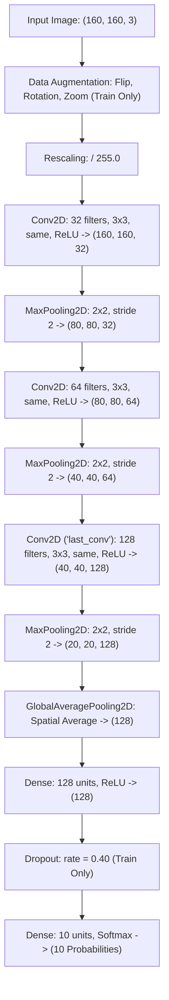

---

## ⚙️ How CNN Training Works

### End-to-End Training Lifecycle

Training deep convolutional models follows an iterative optimization cycle:

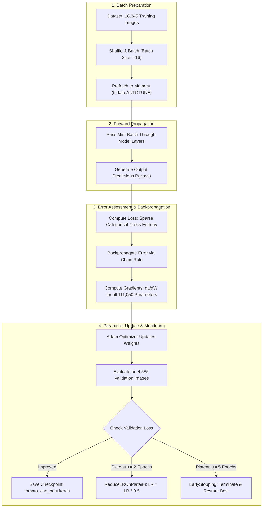

---

### Loss Formulation: Sparse Categorical Cross-Entropy

Because integer labels $y \in \{0, 1, \dots, 9\}$ were used rather than one-hot encoded vectors, the objective function is **Sparse Categorical Cross-Entropy**:

$$\mathcal{L}_{SCE}(\mathbf{y}, \hat{\mathbf{y}}) = -\frac{1}{B} \sum_{b=1}^{B} \log \left( \hat{y}_{b, y_b} \right)$$

Where:
- $B = 16$: Batch size.
- $y_b$: Ground-truth integer class index for sample $b$.
- $\hat{y}_{b, y_b}$: Model's predicted softmax probability for the correct class $y_b$.
- If the model assigns $\hat{y}_{b, y_b} = 1.0$, $\log(1.0) = 0$ (zero loss). If $\hat{y}_{b, y_b} \to 0$, $-\log(\hat{y}) \to \infty$ (heavy penalty).

---

### Optimization with Adam & Learning Rate Scheduling

The network weights are updated using the **Adam (Adaptive Moment Estimation)** optimizer with momentum:

$$\theta_{t+1} = \theta_t - \frac{\alpha}{\sqrt{\hat{v}_t} + \epsilon} \hat{m}_t$$

Where $\hat{m}_t$ tracks the exponentially decaying average of past gradients (first moment) and $\hat{v}_t$ tracks past squared gradients (second moment).

#### Adaptive Learning Rate Schedule Observed in Training:
As recorded in [`tomato_cnn_outputs/training_history.csv`](tomato_cnn_outputs/training_history.csv):
- **Epochs 1–11**: $\alpha = 0.00100$ (Initial exploration rate).
- **Epoch 12**: Reduced by half to $\alpha = 0.00050$ via `ReduceLROnPlateau` as validation loss stabilized around $0.44$.
- **Epoch 17**: Reduced to $\alpha = 0.00025$, where the model reached its **global best validation loss of $0.1637$ and accuracy of $94.57\%$**.
- **Epoch 20**: Final fine-tuning rate of $\alpha = 0.000125$.

---

## 📊 Model Evaluation & Research Benchmarks

### Dataset Distribution & Splits

The dataset comprises **22,930 images** structured across an 80/20 train/validation partition:

| Class ID | Disease Label | Pathogen / Condition | Training Count | Validation Count | Total Images |
|:---:|:---|:---|:---:|:---:|:---:|
| `0` | `Tomato___Bacterial_spot` | *Xanthomonas spp.* (Bacterium) | 1,702 | 425 | 2,127 |
| `1` | `Tomato___Early_blight` | *Alternaria solani* (Fungus) | 1,920 | 480 | 2,400 |
| `2` | `Tomato___Late_blight` | *Phytophthora infestans* (Oomycete) | 1,851 | 463 | 2,314 |
| `3` | `Tomato___Leaf_Mold` | *Passalora fulva* (Fungus) | 1,882 | 470 | 2,352 |
| `4` | `Tomato___Septoria_leaf_spot` | *Septoria lycopersici* (Fungus) | 1,745 | 436 | 2,181 |
| `5` | `Tomato___Spider_mites...` | *Tetranychus urticae* (Acarid pest) | 1,741 | 435 | 2,176 |
| `6` | `Tomato___Target_Spot` | *Corynespora cassiicola* (Fungus) | 1,827 | 457 | 2,284 |
| `7` | `Tomato___Tomato_Yellow_Leaf_Curl_Virus` | *Begomovirus* (Whitefly vector) | 1,961 | 490 | 2,451 |
| `8` | `Tomato___Tomato_mosaic_virus` | *Tobamovirus* (Contact vector) | 1,790 | 448 | 2,238 |
| `9` | `Tomato___healthy` | Healthy leaf control (No pathogen) | 1,926 | 481 | 2,407 |
| **Total** | **10 Classes** | — | **18,345** | **4,585** | **22,930** |

---

### Per-Class Validation Performance (Classification Report)

Evaluated across all **4,585 held-out validation images** (extracted directly from notebook research output):

$$\text{Precision} = \frac{TP}{TP + FP}, \quad \text{Recall} = \frac{TP}{TP + FN}, \quad F_1 = 2 \times \frac{\text{Precision} \times \text{Recall}}{\text{Precision} + \text{Recall}}$$

| Disease Class | Precision | Recall | F1-Score | Support (Validation Images) | Key Diagnostic Observation |
|:---|:---:|:---:|:---:|:---:|:---|
| `Tomato___Bacterial_spot` | 0.9746 | 0.9012 | 0.9364 | 425 | High precision; minor recall loss confused with Septoria. |
| `Tomato___Early_blight` | 0.8899 | 0.9771 | 0.9315 | 480 | High sensitivity; occasionally flags Target Spot as Early Blight. |
| `Tomato___Late_blight` | 0.9566 | 0.9050 | 0.9301 | 463 | Excellent identification of dark water-soaked purplish lesions. |
| `Tomato___Leaf_Mold` | 0.9545 | 0.9809 | 0.9675 | 470 | Distinct velvety underside provides strong diagnostic cues. |
| `Tomato___Septoria_leaf_spot` | 0.9607 | 0.9541 | 0.9574 | 436 | Small dark margins and circular gray centers identified reliably. |
| `Tomato___Spider_mites...` | 0.9143 | 0.8828 | 0.8982 | 435 | Fine speckled stippling occasionally confused with early bacterial spots. |
| `Tomato___Target_Spot` | 0.9217 | 0.8753 | 0.8979 | 457 | Concentric patterns occasionally cross-confused with Early Blight. |
| `Tomato___Tomato_Yellow_Leaf_Curl_Virus` | 0.9452 | 0.9857 | 0.9650 | 490 | High recall on upward curling and chlorotic leaf margins. |
| `Tomato___Tomato_mosaic_virus` | 0.9759 | 0.9933 | 0.9845 | 448 | Top-performing viral pathology with distinctive mottling. |
| `Tomato___healthy` | 0.9714 | 0.9896 | 0.9804 | 481 | Near-perfect separation of healthy controls from pathological samples. |
| **Overall Accuracy** | — | — | **0.9457** | **4,585** | **94.57% Overall Accuracy** |
| **Macro Average** | **0.9465** | **0.9445** | **0.9449** | **4,585** | Balanced performance across all 10 classes. |
| **Weighted Average** | **0.9462** | **0.9457** | **0.9454** | **4,585** | Weighted aggregate matches overall accuracy. |

---

### Confusion Matrix & Error Analysis

The confusion matrix reveals specific agronomic classification challenges:

1. **Target Spot vs. Early Blight**: Both *Corynespora cassiicola* and *Alternaria solani* produce dark brown concentric rings on tomato leaflets. The model misclassifies a small fraction of Target Spot images as Early Blight (recall: $87.53\%$).
2. **Two-Spotted Spider Mites vs. Bacterial Spot**: Early spider mite feeding punctures (chlorotic stippling) closely mimic nascent bacterial spot grease specks before necrotic centers develop (spider mite recall: $88.28\%$).
3. **Healthy Leaf Reliability**: Healthy leaves achieved **98.96% recall** and **97.14% precision**, confirming that healthy leaves are rarely misdiagnosed as infected.

---

### Diagnostic Trade-Offs: False Positives vs. False Negatives

In agricultural AI, not all errors carry equal consequences:

| Error Type | Definition | Agronomic Impact | Mitigation Strategy |
|---|---|---|---|
| **False Negative (FN)** | Model reports *Healthy*, but the plant has *Late Blight*. | **Catastrophic**: *Phytophthora infestans* spreads through fields within days, causing total crop failure. | Lowering the decision threshold for high-consequence pathogens. |
| **False Positive (FP)** | Model reports *Bacterial Spot*, but the leaf is *Healthy*. | **Economic Loss**: Farmer applies unnecessary copper bactericide, incurring chemical expense. | Requiring secondary confirmation or multi-leaf scouting before chemical application. |

---

### Evaluation Pipeline Flowchart


---

## 🔍 Understanding CNN Predictions with Grad-CAM

### The Black-Box Challenge in Plant Pathology

A high validation accuracy score ($94.57\%$) confirms statistical performance, but does not explain *why* the model made a specific prediction. In medical and agricultural imaging, neural networks can fall victim to **spurious correlations** (e.g., classifying an image based on soil color, camera watermarks, or background shadows rather than actual leaf lesions).

**Gradient-weighted Class Activation Mapping (Grad-CAM)** solves this interpretability problem by computing visual heatmaps that highlight the exact spatial regions influencing the network's classification decision.

---

### Mathematical Formulation of Grad-CAM

Grad-CAM uses the gradient of the winning class score $y^c$ with respect to the feature activation map $A^k$ of the final convolutional layer (`last_conv`):

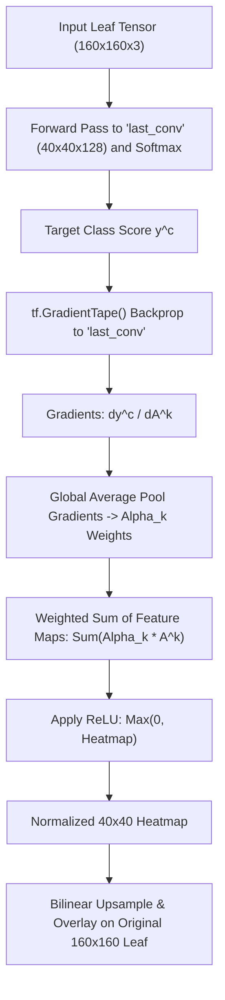

#### Step 1: Compute Neuron Importance Weights ($\alpha_k^c$)
Average the gradients across all spatial locations $(i, j)$ of feature map $k$:

$$\alpha_k^c = \overbrace{\frac{1}{Z} \sum_{i=1}^{U} \sum_{j=1}^{V}}^{\text{Global Average Pooling}} \frac{\partial y^c}{\partial A_{i, j}^k}$$

Where $Z = U \times V = 40 \times 40 = 1,600$ is the spatial area of the `last_conv` layer.

#### Step 2: Compute Weighted Feature Combination & Apply ReLU
Take a weighted sum of all 128 feature maps and apply a ReLU non-linearity:

$$L_{\text{Grad-CAM}}^c = \text{ReLU}\left( \sum_{k=1}^{128} \alpha_k^c A^k \right)$$

- **Why ReLU?** We only care about visual features that have a **positive influence** on the target class score. Features that decrease the score belong to other categories and are eliminated.

---

### Visualizing Model Attention on Tomato Leaves

In this repository's research notebook (`Tomato_Disease_CNN_Research_Updated_160px_CPU.ipynb`, cell 60), the Grad-CAM implementation:
1. Reconstructs a sub-model mapping `[input_image]` $\to$ `[last_conv.output, predictions.output]`.
2. Extracts gradients for the top predicted class.
3. Normalizes the resulting $40 \times 40$ activation grid to $[0.0, 1.0]$.
4. Upsamples the heatmap to $160 \times 160$ using OpenCV/Matplotlib and blends it over the original leaf using a Jet color palette.

> [!NOTE]
> *Interpretability Notice*: Grad-CAM reveals which image regions correlate with the model's decision; it is an **interpretability aid**, not definitive proof of biological causality or independent clinical diagnostic validity.

---

## 🔄 End-to-End System Workflows

The repository implements two coordinated workflows:

### Workflow A: Research & Model Development

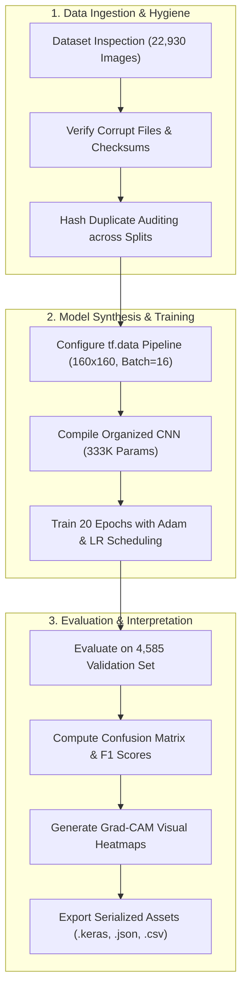

---

### Workflow B: Production Inference & Decision Support

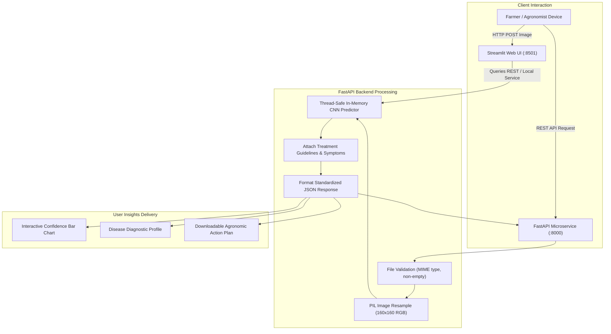

---

### Full System Architecture Diagram

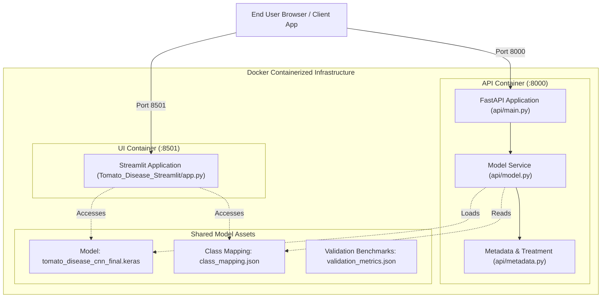

---

## 📖 CNN Technical Concepts Reference Guide

| Term / Concept | Mathematical / Engineering Definition | Concrete Role in This Project |
|---|---|---|
| **Tensor** | A multidimensional array of numerical values characterized by rank and shape. | Represents images: rank-3 $(160, 160, 3)$ or batched rank-4 $(B, 160, 160, 3)$. |
| **Kernel / Filter** | A small learnable weight matrix sliding spatially over input tensors. | $3 \times 3$ matrices that learn edge, texture, and lesion representations. |
| **Feature Map** | The 2D spatial output produced by convolving a kernel across an input. | Intermediate representations showing where specific visual features occur. |
| **Stride** | The step size (in pixels) by which a kernel shifts during convolution or pooling. | Set to $S=1$ for convolutions (smooth scanning) and $S=2$ for pooling (downsampling). |
| **Padding** | Framing the image border with zeros to preserve spatial dimensions. | `"same"` padding prevents spatial reduction during $3 \times 3$ convolutions. |
| **ReLU** | Element-wise non-linear activation: $f(x) = \max(0, x)$. | Introduces non-linearity and mitigates vanishing gradients across layers. |
| **Max Pooling** | Downsampling operation selecting the maximum value in localized windows. | $2 \times 2$ pooling halves spatial dimensions $(160 \to 80 \to 40 \to 20)$. |
| **Global Average Pooling** | Averages each spatial feature map into a single scalar value. | Reduces $20 \times 20 \times 128$ to a 128-D vector, eliminating 99% of dense parameters. |
| **Dropout** | Regularization technique stochastically setting a fraction of activations to zero. | Rate $0.40$ prevents co-adaptation among the 128 dense classification neurons. |
| **Softmax** | Normalizes a vector of $K$ real values into a valid probability distribution. | Projects 10 logits into probabilities summing to $1.0$ for final class assignment. |
| **Cross-Entropy Loss** | Loss function measuring divergence between predicted and true distributions. | Sparse categorical cross-entropy guides backpropagation updates. |
| **Adam Optimizer** | Stochastic gradient descent variant utilizing adaptive first and second moments. | Efficiently updates all 111,050 weights using an adaptive learning rate. |
| **Batch Size** | The number of training samples processed prior to updating model weights. | Configured at $B=16$ for smooth CPU-based gradient updates. |
| **Epoch** | One complete forward and backward pass across all training images. | Trained for 20 epochs over 18,345 images (~8.4 hours on standard CPU). |
| **Overfitting** | When a model learns training noise and fails to generalize to validation data. | Mitigated via data augmentation, dropout (0.4), and Global Average Pooling. |
| **Grad-CAM** | Visual explanation method computing gradients with respect to convolutional maps. | Generates spatial heatmaps identifying which leaf regions triggered the prediction. |

---

## ⚖️ Training vs. Inference Comparison

The model functions under two distinct modes depending on whether it is optimizing weights or serving user predictions:

| Component / Layer | Training Mode (`training=True`) | Inference Mode (`training=False`) |
|---|---|---|
| **Data Augmentation** | **Active**: Images are randomly flipped, rotated ($\pm 36^\circ$), and zoomed ($\pm 10\%$). | **Deactivated**: Acts as an identity passthrough; input images are evaluated deterministically. |
| **Dropout Regularization** | **Active**: Exactly $40\%$ of dense neurons are randomly zeroed out per mini-batch. | **Deactivated**: All 128 dense neurons remain active; outputs are unscaled. |
| **Gradient Calculation** | **Active**: `tf.GradientTape()` records layer activations and calculates parameter gradients. | **Deactivated**: No computational graph is retained; execution runs forward-only. |
| **Backpropagation & Weights** | **Active**: Adam optimizer calculates gradient moments and updates the 111,050 weights. | **Deactivated**: Weights are strictly frozen and read-only. |
| **Loss Computation** | **Active**: Categorical cross-entropy is calculated to compute parameter loss. | **Deactivated**: Only softmax probabilities and $\arg\max$ outputs are computed. |
| **Execution Environment** | Executed in Jupyter Notebook or batch training scripts. | Executed inside FastAPI ASGI workers or Streamlit app runners. |
| **Batch Size** | Fixed mini-batches ($B = 16$). | Dynamic batches: handles single images $(1, 160, 160, 3)$ or concurrent API requests. |

---

## 🌿 Supported Tomato Leaf Disease Classes & Agronomic Pathology Guide

The deep learning model discriminates among **10 distinct physiological and pathological leaf categories** (9 biotic stress conditions and 1 healthy control). Below is an exhaustive agronomic reference detailing pathogen biology, epidemiology, visual diagnostics, lookalike differentiation, and Integrated Pest Management (IPM) guidelines.

### Summary Overview Table

| ID | Class Label (Machine Key) | Common Name | Biological Agent & Taxon | Primary Foliar Symptoms |
|:--:|:--------------------------|:------------|:-------------------------|:------------------------|
| `0` | `Tomato___Bacterial_spot` | **Bacterial Spot** | *Xanthomonas spp.* (Bacterium) | Small (1–3 mm), dark, greasy, water-soaked lesions with chlorotic halos; blossom drop. |
| `1` | `Tomato___Early_blight` | **Early Blight** | *Alternaria solani* (Ascomycete fungus) | Concentric bullseye target rings on lower foliage surrounded by prominent yellow halos. |
| `2` | `Tomato___Late_blight` | **Late Blight** | *Phytophthora infestans* (Oomycete water mold) | Rapid, large, purplish-brown water-soaked collapse; white downy sporulation underneath. |
| `3` | `Tomato___Leaf_Mold` | **Leaf Mold** | *Passalora fulva* (Fungus) | Diffuse pale-yellow upper leaf spots paired with dense olive-green velvety mold below. |
| `4` | `Tomato___Septoria_leaf_spot` | **Septoria Leaf Spot** | *Septoria lycopersici* (Fungus) | Small circular spots with dark brown margins, sunken grayish-white centers, and black pycnidia specks. |
| `5` | `Tomato___Spider_mites...` | **Two-Spotted Spider Mites** | *Tetranychus urticae* (Acarid arachnid) | Chlorotic stippling and yellow speckling; delicate silk webbing; bronzed brittle foliage. |
| `6` | `Tomato___Target_Spot` | **Target Spot** | *Corynespora cassiicola* (Fungus) | Circular brown lesions with pale centers and concentric rings across the entire canopy. |
| `7` | `Tomato___Tomato_Yellow_Leaf_Curl_Virus` | **Yellow Leaf Curl (TYLCV)** | *Begomovirus* (Whitefly-transmitted) | Severe upward and inward leaf curling, bright yellow chlorotic margins, and severe stunting. |
| `8` | `Tomato___Tomato_mosaic_virus` | **Mosaic Virus (ToMV)** | *Tobamovirus* (Mechanically transmitted) | Mottled light/dark green mosaic patches, blistering, fern-leaf narrowing, and plant dwarfing. |
| `9` | `Tomato___healthy` | **Healthy Leaf** | Negative Control Baseline | Vibrant, uniform green lamina, intact vascular venation, and zero necrotic or chlorotic lesions. |

---

### In-Depth Pathological Profiles (Classes 0–9)

#### Class 0: Bacterial Spot
- **Causal Pathogens**: *Xanthomonas perforans*, *Xanthomonas euvesicatoria*, *Xanthomonas gardneri*, and *Xanthomonas vesicatoria* (Gram-negative rod-shaped aerobic bacteria).
- **Disease Cycle & Transmission**: Overwinters on contaminated seed coats, volunteer tomato plants, and solanaceous crop debris. Transmitted rapidly across canopies via rain splash, overhead sprinkler irrigation, aerosolized wind-driven rain, and field workers handling wet foliage. Bacteria penetrate through natural foliar openings (stomata and hydathodes) or physical micro-wounds created by blowing sand, insect feeding, or pruning shears.
- **Favorable Weather Conditions**: High ambient temperatures ($24^\circ\text{C} - 30^\circ\text{C}$ / $75^\circ\text{F} - 86^\circ\text{F}$) accompanied by high relative humidity ($>80\%$) and continuous leaf wetness exceeding 3 to 4 hours.
- **Symptom Progression**:
  - *Foliar*: Begins as tiny ($<2\text{ mm}$), circular to irregular water-soaked spots on leaflets. Lesions rapidly darken into brownish-black, greasy-textured necrotic specks often outlined by an irregular yellow halo. Under severe pressure, lesions coalesce, leading to general foliar blighting, scorch-like collapse, and extensive defoliation.
  - *Stems & Flowers*: Dark, elongated lesions appear on green stems. Blossom drop occurs when pedicels become infected, drastically reducing fruit set.
  - *Fruit*: Small, black, raised scabs develop on green fruits, eventually becoming sunken with roughened brown margins, ruining commercial marketability.
- **Diagnostic Lookalikes & Differential Clues**: Frequently confused with *Septoria Leaf Spot*. Bacterial spot lesions maintain an irregular, water-soaked greasy boundary and completely lack fungal fruiting bodies. Septoria spots are more uniformly circular with sunken tan centers containing visible black pinpoint dots (pycnidia).
- **Integrated Pest Management (IPM)**:
  - *Cultural Controls*: Strict 2- to 3-year crop rotation avoiding peppers and eggplants; plant certified hot-water-treated or bleach-sanitized seed; convert from overhead to root-zone drip irrigation; never cultivate or harvest fields when leaves are wet.
  - *Biological Controls*: Foliar bio-bactericides containing *Bacillus subtilis* or target-specific bacteriophages applied in late afternoon to avoid UV degradation.
  - *Chemical Intervention*: Preventative copper-based bactericides (copper hydroxide or copper octanoate) tank-mixed with an ethylene bisdithiocarbamate (EBDC) fungicide like mancozeb, which breaks down copper-tolerant bacterial cell walls.

---

#### Class 1: Early Blight
- **Causal Pathogen**: *Alternaria solani* (Dematiaceous hyphomycete fungus).
- **Disease Cycle & Transmission**: A ubiquitous soil-borne and seed-borne necrotrophic fungus that overwinters as mycelium or chlamydospores in solanaceous crop residues. Large multicellular conidia are released into air currents as relative humidity drops in mid-morning and are dispersed by wind, splashing water, insects, and contaminated farm machinery.
- **Favorable Weather Conditions**: Warm, humid weather with temperatures between $24^\circ\text{C} - 29^\circ\text{C}$ ($75^\circ\text{F} - 84^\circ\text{F}$) and alternating cycles of heavy dew or rainfall followed by warm dry spells.
- **Symptom Progression**:
  - *Foliar*: Symptoms typically initiate on the oldest, shaded, senescing leaves near the base of the plant. Small brown to black spots enlarge into circular lesions up to $10 - 15\text{ mm}$ in diameter. As the fungus advances through leaf tissue, it produces dark, elevated, concentric ridges forming a prominent **target-board (bullseye)** morphology. A pronounced chlorotic yellow halo surrounds each mature lesion due to the diffusion of alternaric acid and solanapyrone phytotoxins.
  - *Defoliation*: Heavily infected lower leaves turn completely yellow, wither, and drop, exposing green tomato fruits to direct sunlight and catastrophic **sunscald**.
  - *Stems & Fruit*: Causes "collar rot" girdling on young seedlings; produces sunken, leathery, black lesions with concentric rings at the stem end of mature tomato fruit.
- **Diagnostic Lookalikes & Differential Clues**: Readily confused with *Target Spot* (*Corynespora cassiicola*). Early blight lesions generally display more pronounced, wider concentric ridges and wider chlorotic halos, and are strictly concentrated on the lower canopy during early disease onset.
- **Integrated Pest Management (IPM)**:
  - *Cultural Controls*: Bottom-prune lower foliage (strip lower 30–45 cm of leaves after first fruit cluster develops) to interrupt soil spore splashing; install plastic or straw mulch over bare soil; practice 3-year non-solanaceous rotations.
  - *Biological Controls*: Preventative foliar inoculations with *Trichoderma harzianum* or *Bacillus amyloliquefaciens*.
  - *Chemical Intervention*: Protectant sprays with chlorothalonil or mancozeb at first blossom; alternate with systemic site-specific chemistries (e.g., azoxystrobin [FRAC 11], difenoconazole [FRAC 3], or boscalid [FRAC 7]) to mitigate fungal resistance.

---

#### Class 2: Late Blight
- **Causal Pathogen**: *Phytophthora infestans* (Heterothallic Oomycete; historically infamous for the 1845 European Potato Famine).
- **Disease Cycle & Transmission**: One of the most destructive agricultural plant diseases in human history. Does not survive in dry soil; overwinters in living host tissue (potato tubers, greenhouse crops, volunteer plants). Spreads via fragile microscopic sporangia carried on cool, moist wind currents for tens of miles. In free water, sporangia release motile biflagellate zoospores that swim to stomata, encyst, and penetrate host tissue within hours.
- **Favorable Weather Conditions**: Cool, wet, persistently foggy, or rainy conditions. Ideal temperatures range from $15^\circ\text{C} - 22^\circ\text{C}$ ($59^\circ\text{F} - 72^\circ\text{F}$) coupled with relative humidity exceeding $90\%$. Infections halt if temperatures exceed $30^\circ\text{C}$ with dry air.
- **Symptom Progression**:
  - *Foliar*: Appears as rapid, pale-green to olive-green, water-soaked, irregular lesions that expand aggressively regardless of leaf veins. Lesions quickly turn greasy, dark brown to purplish-black, collapsing leaf architecture. In early mornings or humid fog, a delicate, frosty **white downy fungal growth** (sporangiophores and sporangia) emerges on the underside of infected leaves around the lesion margins.
  - *Stems*: Dark brown to black greasy girdling lesions appear on petioles and main stems, causing whole branches to snap and wither.
  - *Fruit*: Green and ripe fruit develop large, firm, irregular, greasy olive-brown lesions with a corrugated texture that quickly rot.
  - *Destruction Velocity*: An entire commercial field can transition from a few localized spots to total blackened defoliation and collapse in **5 to 10 days**.
- **Diagnostic Lookalikes & Differential Clues**: Unlike Early Blight and Target Spot, Late Blight lesions lack concentric rings, cross over major veins without boundary restriction, and produce characteristic frosty white downy sporulation on the leaf underside under high humidity.
- **Integrated Pest Management (IPM)**:
  - *Emergency Action*: Inspect fields daily during cool, rainy weather. Immediately rogue, double-bag in plastic, and bury or incinerate infected plants; **never compost late-blight tissue**.
  - *Cultivar Resistance*: Plant modern tomato cultivars bred with *Ph-2* and *Ph-3* resistance genes (e.g., Mountain Magic, Defiant, Iron Lady).
  - *Chemical Intervention*: Maintain preventative coverage with chlorothalonil, mancozeb, or fixed copper before rainy fronts. If disease is reported in your geographic region, apply targeted systemic oomyceticides (e.g., cyazofamid [FRAC 21], mandipropamid [FRAC 40], or cymoxanil [FRAC 27]).

---

#### Class 3: Leaf Mold
- **Causal Pathogen**: *Passalora fulva* (syn. *Cladosporium fulvum*) (Ascomycete fungus).
- **Disease Cycle & Transmission**: A specialized biotrophic pathogen primarily plaguing protected cultivation (polyhouses, glasshouses, and high tunnels), but also occurring in dense open fields in warm humid zones. Overwinters as conidia or sclerotia-like mycelium in greenhouse framework cracks, dry leaves, and seed. Spores are easily dislodged by airflow, workers' clothes, and pruning tools.
- **Favorable Weather Conditions**: High relative humidity ($>85\%$, with optimal infection occurring at $90\%-95\%$) and warm temperatures between $21^\circ\text{C} - 24^\circ\text{C}$ ($70^\circ\text{F} - 75^\circ\text{F}$). Unlike most foliar fungi, *Passalora fulva* can establish severe infection without free liquid water droplets if ambient humidity remains consistently high.
- **Symptom Progression**:
  - *Upper Leaf Surface*: Initially manifests as diffuse, pale-green to bright-yellow chlorotic spots with indistinct, fading margins on older leaves.
  - *Lower Leaf Surface*: Directly beneath the yellow patches, the fungus erupts into dense, velvety, olive-green to chocolate-brown fungal mold composed of thousands of conidiophores and conidia.
  - *Defoliation*: Infected leaflets curl upward, turn completely yellow, wither into dry papery brown husks, and drop. Fruit infection is rare, but severe defoliation starves developing tomatoes, drastically reducing fruit size and sugar content.
- **Diagnostic Lookalikes & Differential Clues**: Unique among tomato foliar diseases: the combination of pale yellow upper spots paired with dense olive-green velvet mold underneath is distinct. Powdery mildew produces powdery white growth on the *upper* leaf surface.
- **Integrated Pest Management (IPM)**:
  - *Climate Management*: Maximize greenhouse ventilation; run horizontal airflow (HAF) fans continuously; space rows widely; apply heat before sunrise to prevent dew point condensation on leaves.
  - *Foliage Management*: Prune lower leaves up to the ripening fruit cluster to facilitate under-canopy air movement; strictly avoid overhead watering.
  - *Cultivar Resistance*: Utilize greenhouse tomato hybrids bred with *Cf* resistance genes (*Cf-2*, *Cf-4*, *Cf-9*).
  - *Chemical Intervention*: Copper fungicides, chlorothalonil, or mancozeb applied as preventative measures when greenhouse humidity cannot be maintained below 85%.

---

#### Class 4: Septoria Leaf Spot
- **Causal Pathogen**: *Septoria lycopersici* (Ascomycete fungus).
- **Disease Cycle & Transmission**: Overwinters in solanaceous weed hosts (such as *Solanum carolinense* / horsenettle and black nightshade), contaminated seed, and decaying tomato vines. Fungal pycnidia produce mucilaginous spores that are forcibly extruded and splashed upward onto lower leaves by rain or overhead watering.
- **Favorable Weather Conditions**: Warm, wet, humid weather with temperatures between $20^\circ\text{C} - 25^\circ\text{C}$ ($68^\circ\text{F} - 77^\circ\text{F}$) combined with extended periods of rain, persistent fog, and high relative humidity.
- **Symptom Progression**:
  - *Foliar*: Symptoms erupt on the oldest lower foliage following fruit set. Lesions are numerous, small, and remarkably uniform: circular spots measuring $1.5 - 3\text{ mm}$ across.
  - *Lesion Anatomy*: The outer margin of each lesion is dark brown to blackish, while the center dries into a sunken, distinctive **grayish-white or tan papery center**.
  - *Microscopic Diagnostic Specks*: Within the gray center of mature lesions, several tiny, black, pimple-like specks (**pycnidia**, the asexual fruiting structures) become visible upon close inspection or with a 10× hand lens.
  - *Defoliation Cycle*: As hundreds of spots cover individual leaflets, leaves turn yellow, chlorotic, shrivel, and drop prematurely. Defoliation ascends from the soil upward, stripping the canopy and leaving tomatoes exposed to sunscald. Fruits are rarely infected directly.
- **Diagnostic Lookalikes & Differential Clues**: Closely resembles *Bacterial Spot*. Key distinction: Septoria spots are uniformly circular with distinct sunken gray/tan centers and visible black pycnidia specks. Bacterial spot lesions are irregular, water-soaked, lack pycnidia, and have a greasy texture.
- **Integrated Pest Management (IPM)**:
  - *Cultural Controls*: Eradicate horsenettle and nightshade weeds around field perimeters; mulch beds with 5–8 cm of straw or UV-reflective plastic mulch to block soil-borne spore splashback; stake and prune indeterminate vines.
  - *Crop Rotation*: Maintain a rigorous 3-year non-solanaceous rotation schedule.
  - *Chemical Intervention*: Apply protective fungicides (chlorothalonil, copper hydroxide, or mancozeb) starting at transplant establishment or early fruit set; repeat on a 7- to 10-day cycle during rainy periods.

---

#### Class 5: Two-Spotted Spider Mites
- **Causal Organism**: *Tetranychus urticae* (Acarid pest; Order Trombidiformes; Family Tetranychidae).
- **Biology & Life Cycle**: Microscopic ($0.4\text{ mm}$), eight-legged yellowish-green arachnids with two distinct dark lateral spots on the abdomen. Females lay hundreds of spherical eggs on leaf undersides. Under hot conditions ($30^\circ\text{C}$), the lifecycle from egg to reproducing adult compresses into an astonishing **5 to 7 days**, enabling exponential population explosions that overwhelm plants before growers notice.
- **Feeding Mechanism**: Mites colonize the sheltered underside of leaves, inserting sharp piercing-sucking stylets into plant cells to drain sap and chlorophyll.
- **Favorable Weather Conditions**: Hot, dry, dusty, drought-stressed environments ($>27^\circ\text{C} - 35^\circ\text{C}$ / $80^\circ\text{F} - 95^\circ\text{F}$) with low relative humidity ($<50\%$). Farm roads generating dust kick-up exacerbate infestations by suffocating natural predatory insects.
- **Symptom Progression**:
  - *Foliar*: Early damage appears on the upper leaf surface as fine, pale-yellow, speckled **stippling** (flecking) where mesophyll cells have been emptied of chlorophyll.
  - *Webbing & Bronzing*: As the mite colony expands, fine, dense, silky webbing covers the leaf undersides, petiole junctions, and growing tips. Leaves turn yellow, bronze, dry, brittle, and drop.
  - *Plant Decline*: Photosynthesis collapses, plants become severely stunted, and exposed fruit develops pale chlorotic spots and sunscald.
- **Diagnostic Lookalikes & Differential Clues**: Early stippling can be mistaken for micronutrient deficiency (e.g., magnesium or nitrogen chlorosis) or nascent virus mottling. Confirm spider mites by inspecting leaf undersides with a 10× hand lens to observe crawling mites, spherical eggs, and webbing, or tap a suspect leaf over clean white paper.
- **Integrated Pest Management (IPM)**:
  - *Dust Suppression & Humidity*: Water gravel farm roads to suppress dust; provide overhead misting or sprinkle irrigation in hot weather (spider mites detest moisture and wash off easily).
  - *Biological Control*: In greenhouses and high tunnels, release predatory mites (*Phytoseiulus persimilis* or *Neoseiulus californicus*) at the first sign of stippling before webs develop.
  - *Chemical & Soft Controls*: Horticultural oils, insecticidal soaps, or azadirachtin (neem oil) applied thoroughly to leaf undersides. If synthetic acaricides are required (e.g., abamectin, bifenazate, spiromesifen), rotate mode of action to avoid rapid miticide resistance.
  - *Caution*: Avoid broad-spectrum synthetic pyrethroids (e.g., bifenthrin, permethrin), which kill beneficial predatory insects and consistently trigger massive secondary spider mite outbreaks.

---

#### Class 6: Target Spot
- **Causal Pathogen**: *Corynespora cassiicola* (Ascomycete fungus).
- **Disease Cycle & Transmission**: A polyphagous necrotrophic fungal pathogen with a host range spanning over 530 plant species (including soybean, cucumber, papaya, and cotton). Overwinters in crop debris and wild weed hosts. Conidia are dispersed through wind currents and splashed by rain across the upper and middle foliage canopy.
- **Favorable Weather Conditions**: Warm, humid tropical and subtropical environments; optimal temperatures between $25^\circ\text{C} - 32^\circ\text{C}$ ($77^\circ\text{F} - 90^\circ\text{F}$) combined with prolonged periods of leaf wetness and high relative humidity ($>80\%$).
- **Symptom Progression**:
  - *Foliar*: Commences as small, pinpoint, water-soaked brown spots on the upper leaf surface. Spots enlarge into circular to sub-circular necrotic lesions ($2 - 12\text{ mm}$).
  - *Concentric Ring Pattern*: Mature lesions display pale brown to tan centers bordered by multiple dark brown **concentric rings**, visually mimicking a shooting target. Lesions coalesce rapidly, causing widespread foliar blighting, curled leaf edges, and severe defoliation throughout the middle and upper canopy.
  - *Stems & Fruit*: Stems develop dark, elongated brown fissures. Green and ripe fruits develop small, circular, sunken lesions with dark brown margins, frequently cracking open and allowing secondary bacterial soft rot organisms to enter.
- **Diagnostic Lookalikes & Differential Clues**: Closely mimics *Early Blight*. Differential markers: Target Spot lesions are typically smaller, more circular, have narrower yellow halos, and appear concurrently throughout the middle and upper canopy, whereas Early Blight initiates strictly on the oldest lower leaves and features wider, darker concentric bands.
- **Integrated Pest Management (IPM)**:
  - *Canopy Aeration*: Stake, trellis, and sucker tomato plants to maximize air circulation through the canopy; avoid excessive nitrogen fertilization, which generates dense foliage that traps moisture.
  - *Residue Management*: Deep-till or remove solanaceous crop residues immediately following final harvest; rotate with non-host crops like corn or sorghum.
  - *Chemical Intervention*: Protectant fungicides (chlorothalonil, mancozeb) alternated with strobilurin (pyraclostrobin [FRAC 11]) or SDHI chemistries (fluxapyroxad [FRAC 7]).

---

#### Class 7: Tomato Yellow Leaf Curl Virus (TYLCV)
- **Causal Pathogen**: *Tomato yellow leaf curl virus* (TYLCV), family *Geminiviridae*, genus *Begomovirus* (Single-stranded circular DNA virus).
- **Vector & Transmission**: Transmitted with high efficiency by the **Silverleaf Whitefly** (*Bemisia tabaci* complex, specifically biotypes B and Q). **Not seed-transmitted** in commercial tomato seed and **not transmissible mechanically** by pruning tools or human contact. Adult whiteflies acquire the virus in 15–30 minutes of feeding on infected hosts, undergo a 20-hour latent period, and subsequently transmit the virus to healthy plants for the remainder of their adult life (persistent circulative non-propagative transmission).
- **Favorable Weather Conditions**: Warm, dry climates that foster explosive whitefly population growth; regions with continuous solanaceous cultivation without winter freeze periods or host-free breaks.
- **Symptom Progression**:
  - *Foliar*: Marked upward and inward cupping and curling of leaflet margins (giving leaves a characteristic spoon-like or cup-like shape). Leaflets exhibit pronounced **marginal and interveinal chlorosis** (bright yellow borders), reduced surface area, and thick leathery texture.
  - *Architecture & Stunting*: Internodes become severely shortened, giving the plant a stunted, bushy, compact erect appearance.
  - *Blossom & Yield Loss*: Heavy blossom drop occurs; flowers abort before fruit set. If infected during the early vegetative stage, tomato yield is **reduced by 80% to 100%**.
- **Diagnostic Lookalikes & Differential Clues**: Upward leaf curling can easily be confused with *Physiological Leaf Roll* (a non-infectious stress disorder triggered by heavy pruning, high nitrogen, or drought). Physiological leaf roll causes thick leathery upward curling on lower leaves, but **never produces yellow chlorotic margins, leaf size reduction, or plant stunting**.
- **Integrated Pest Management (IPM)**:
  - *Genetic Resistance*: The most effective, sustainable control is planting hybrid tomato varieties bred with *Ty* resistance genes (*Ty-1*, *Ty-3*, *Ty-5*).
  - *Vector Exclusion*: Install ultra-fine 50-mesh insect-exclusion screens on greenhouse vents; apply UV-reflective silver plastic mulches on field beds to disorient incoming whiteflies.
  - *Rogueing*: Immediately pull up, seal in airtight plastic bags, and incinerate infected plants to eliminate viral reservoirs.
  - *Vector Management*: Monitor with yellow sticky cards; rotate systemic insecticides (neonicotinoids, diamides, flupyradifurone) during nursery seedling stages, respecting resistance management.

---

#### Class 8: Tomato Mosaic Virus (ToMV)
- **Causal Pathogen**: *Tomato mosaic virus* (ToMV), family *Virgaviridae*, genus *Tobamovirus* (Rigid rod-shaped positive-sense single-stranded RNA virus; closely related to Tobacco Mosaic Virus [TMV]).
- **Vector & Transmission**: **Extremely infectious and mechanically transmitted**. It spreads through touch, pruning knives, staking twine, trellises, grafting tools, animal vectors, and workers brushing past wet plants. The virus is exceptionally stable outside living hosts: it can survive for decades in dry plant debris, on wooden greenhouse frames, in contaminated soil, and in commercial tobacco products (smokers and tobacco chewers can inadvertently transmit ToMV to tomato vines). Also transmissible on contaminated seed coats.
- **Favorable Weather Conditions**: Thrives across a wide temperature spectrum ($20^\circ\text{C} - 32^\circ\text{C}$); symptoms become exacerbated under high nitrogen fertilization and low light intensities.
- **Symptom Progression**:
  - *Foliar*: Foliage develops a distinct **mosaic pattern** of alternating dark green, light green, and chlorotic yellowish mottled patches. Leaflets exhibit blister-like bubbling, distortion, puckering, and severe lamina narrowing into strap-like or "fern-leaf" (shoestring) morphology.
  - *Architecture*: Plants become stunted with pale, spindly apical growth.
  - *Fruit*: Green fruit shows internal brown necrotic rings (**brown wall** or internal vascular browning), while ripe fruit develops uneven ripening, blotchy yellow marbling, and unmarketable flavor.
- **Diagnostic Lookalikes & Differential Clues**: Resembles *Cucumber Mosaic Virus* (CMV) and *Potato Virus Y* (PVY). ToMV is distinguished by its extreme persistence, lack of aphid transmission, and intense blistering distortion.
- **Integrated Pest Management (IPM)**:
  - *Hygiene & Sanitation*: Workers must wash hands thoroughly with soap or dip hands in a 20% non-fat dry milk solution (milk proteins bind and neutralize tobamovirus particles) before touching crops. Strictly prohibit smoking or tobacco products near tomato facilities.
  - *Tool Sterilization*: Soak pruning shears, knives, and harvesting bins in 10% household bleach (freshly prepared) or virucidal sanitizers between rows.
  - *Seed Decontamination*: Treat seed with a 10% trisodium phosphate (TSP) wash or hot-water soak ($50^\circ\text{C}$ for 25 minutes) to eradicate external viral particles.
  - *Genetic Resistance*: Plant commercial varieties carrying the dominant *Tm-2* or *Tm-2^2* resistance genes.
  - *Zero Chemical Cure*: No chemical viricides exist. Once infected, plants cannot be cured and must be carefully culled and destroyed.

---

#### Class 9: Healthy Tomato Leaf
- **Classification Baseline**: Negative control indicating robust, uninfected foliage.
- **Morphological Characteristics**: Leaves exhibit uniform, deep emerald-green pigmentation across the entire leaf lamina. Leaflet margins are crisp, intact, and naturally serrated without upward or downward rolling. Foliage is entirely free of necrotic spots, water-soaked margins, fungal molds, chlorotic halos, or viral mosaic mottling. Vascular veins appear translucent green, healthy, and unobstructed.
- **Agronomic Maintenance Protocols**:
  - *Soil & Nutrition*: Maintain balanced macronutrient (N-P-K) and micronutrient (Ca, Mg, Fe, B) availability. Prevent calcium deficiency to avoid physiological disorders like blossom end rot.
  - *Irrigation Regimen*: Deliver consistent soil moisture via root-zone drip irrigation (1.5 to 2 inches of water per week), ensuring leaves remain dry.
  - *Preventative Scouting*: Execute bi-weekly foliar scouting to identify nascent abiotic stresses or initial pathogen incursions before threshold spread occurs.

---

### Comparative Differential Diagnosis Matrix

When evaluating suspicious tomato foliar symptoms, use this diagnostic matrix to cross-examine visual features and avoid common field misdiagnoses:

| Disease / Condition | Lesion Geometry | Lesion Center & Margins | Halos Present? | Leaf Underside Feature | Primary Mode of Spread | Key Distinguishing Field Marker |
|:---|:---|:---|:---:|:---|:---|:---|
| **Bacterial Spot** | Small ($1 - 3\text{ mm}$), irregular | Dark brown, greasy, water-soaked | Yes (narrow yellow) | Flat, water-soaked | Rain splash, wet equipment | Greasy texture; completely lacks fungal pycnidia. |
| **Early Blight** | Large ($5 - 15\text{ mm}$), circular | Dark brown with concentric bullseye rings | Yes (prominent yellow) | Dark concentric ridges | Wind, splashing conidia | Prominent concentric target rings starting on oldest lower foliage. |
| **Late Blight** | Large, expansive, irregular | Olive-green turning purplish-black, greasy | No (pale green border) | Frosty white downy mold | Windborne sporangia | Rapid collapse of whole leaflets; white mold underneath during humid mornings. |
| **Leaf Mold** | Indefinite, diffuse patches | Upper leaf pale greenish-yellow spots | No | Dense olive-green velvety mold | Greenhouse airflow, humidity | Upper yellow blotch aligns with olive-green velvet mold below. |
| **Septoria Leaf Spot** | Small ($1.5 - 3\text{ mm}$), circular | Sunken grayish-white / tan centers with dark borders | Minor yellow halo | Sunken gray center | Splashing rain, dew | Distinct gray center containing visible tiny black pinpoint pycnidia. |
| **Two-Spotted Spider Mites** | Fine speckled stippling ($<0.5\text{ mm}$) | Yellowish-white feeding puncture flecks | No | Fine silky webbing & active mites | Dry wind, walking mites | Microscopic mites crawling on leaf undersides among fine silk webbing. |
| **Target Spot** | Medium ($2 - 10\text{ mm}$), circular | Brown with pale tan centers and target rings | Moderate yellow halo | Brown necrotic centers | Windborne conidia, rain | Target rings distributed evenly across upper and middle canopy. |
| **Yellow Leaf Curl (TYLCV)** | Upward cupped / curled | Distorted leaflets, bright yellow margins | Diffuse marginal chlorosis | Clean; no fungal mold | Silverleaf Whitefly vector | Upward spoon-like leaf curling paired with yellow margins and severe stunting. |
| **Mosaic Virus (ToMV)** | Blistered, distorted, fern-like | Alternating light green and dark green patches | Mottled mosaic | Distorted bubbling | Mechanical touch, pruning | Mottled light/dark green mosaic blisters and fern-like leaf distortion. |
| **Healthy Leaf** | Natural flat serrated leaflet | Uniform vibrant green lamina | None | Clean green epidermis | N/A (Normal growth) | Complete absence of chlorosis, necrosis, curling, or sporulation. |

---

---

## 📁 Project Directory Structure

```text
Tomato Plant Diseases Augmented/
├── .github/
│   ├── ISSUE_TEMPLATE/
│   │   ├── bug_report.md               # GitHub issue template for bugs
│   │   └── feature_request.md          # GitHub issue template for features
│   ├── pull_request_template.md        # Standardized PR review checklist
│   └── workflows/
│       └── ci.yml                      # GitHub Actions CI workflow (Pytest + Docker)
├── api/
│   ├── __init__.py                     # API package marker
│   ├── main.py                         # FastAPI routes, CORS, lifespan & error handlers
│   ├── metadata.py                     # Disease symptom profiles & agronomic recommendations
│   ├── model.py                        # Thread-safe CPU inference service & image preprocessor
│   └── schemas.py                      # Pydantic v2 validation models
├── docs/
│   └── images/
│       ├── cnn_general_architecture.jpg # Visual breakdown of general CNN stages
│       └── cnn_leaf_pipeline.jpg       # Leaf disease CNN feature extraction pipeline
├── tests/
│   ├── __init__.py
│   └── test_api.py                     # Pytest suite verifying model, mappings, and API
├── Tomato_Disease_Streamlit/
│   ├── app.py                          # Streamlit web dashboard
│   └── tomato_cnn_outputs/             # Local model weights and mappings for UI
├── tomato_cnn_outputs/
│   ├── class_mapping.json              # Integer-to-class name JSON map
│   ├── tomato_cnn_best.keras           # Optimal checkpoint weights (Epoch 17)
│   ├── tomato_disease_cnn_final.keras  # Final serialized model
│   ├── training_history.csv            # 20-epoch training loss, accuracy, and learning rate
│   └── validation_metrics.json         # Benchmarks: 94.57% accuracy, 0.1637 loss
├── Dataset/                            # (Optional) Image dataset containing train/ and valid/
├── Dockerfile                          # Production container specification for FastAPI backend
├── Dockerfile.streamlit                # Production container specification for Streamlit UI
├── docker-compose.yml                  # Multi-container orchestration runner
├── LICENSE                             # Apache 2.0 open-source license
├── requirements.txt                    # Project dependencies (FastAPI, Streamlit, TF, Pytest)
├── .gitignore                          # Git exclusions (caches, virtualenvs, datasets)
├── .dockerignore                       # Docker build context exclusions
└── README.md                           # Comprehensive documentation & architectural guide
```

---

## 🐳 Quick Start: Docker (Recommended)

Run both the **FastAPI REST API** and the **Streamlit Web Dashboard** in isolated containers with a single command:

```bash
docker compose up --build
```

- **FastAPI Interactive Swagger UI**: [http://localhost:8000/docs](http://localhost:8000/docs)
- **FastAPI Alternative ReDoc UI**: [http://localhost:8000/redoc](http://localhost:8000/redoc)
- **Streamlit Web Dashboard**: [http://localhost:8501](http://localhost:8501)

To stop the services:
```bash
docker compose down
```

---

## 💻 Local Installation & Setup

### 1. Prerequisites
- Python 3.12 (or 3.10+)
- Git

### 2. Clone Repository & Setup Virtual Environment
```bash
# Clone the repository
git clone https://github.com/your-username/tomato-plant-disease-cnn.git
cd tomato-plant-disease-cnn

# Create a virtual environment
python -m venv .venv

# Activate the virtual environment
# On Windows PowerShell:
.\.venv\Scripts\Activate.ps1
# On Linux / macOS:
source .venv/bin/activate

# Install dependencies
pip install --upgrade pip
pip install -r requirements.txt
```

---

## 🚀 Running the Services

### 1. FastAPI REST Backend
Start the high-performance ASGI server:
```powershell
& ".\.venv\Scripts\python.exe" -m uvicorn api.main:app --host 0.0.0.0 --port 8000 --reload
```
Interactive Swagger documentation is available at [http://localhost:8000/docs](http://localhost:8000/docs).

### 2. Streamlit Web Dashboard
Launch the agronomic diagnosis interface:
```powershell
& ".\.venv\Scripts\python.exe" -m streamlit run Tomato_Disease_Streamlit/app.py
```
Open your browser at [http://localhost:8501](http://localhost:8501) to upload leaf images, view probability distributions, and download diagnostic reports.

### 3. Jupyter Research Notebooks
To explore dataset inspection, model training, evaluation metrics, and Grad-CAM:
```bash
jupyter notebook Tomato_Disease_CNN_Research_Updated_160px_CPU.ipynb
```

---

## 📡 REST API Documentation & Endpoints

| Method | Endpoint | Description |
|:------:|:---------|:------------|
| `GET` | `/` | Root endpoint returning service status and route directory. |
| `GET` | `/health` | Healthcheck reporting model loaded state, class count, and timestamp. |
| `GET` | `/classes` | Full list and index mapping of all 10 supported tomato disease classes. |
| `GET` | `/model-info` | Architecture metadata, input shape, training epochs, and validation benchmarks. |
| `POST` | `/predict` | Multipart image upload returning top prediction, probability vector, symptoms, and treatment. |

### Example cURL Request (`/predict`)

```bash
curl -X POST "http://localhost:8000/predict" \
     -H "accept: application/json" \
     -H "Content-Type: multipart/form-data" \
     -F "file=@sample_leaf.jpg;type=image/jpeg"
```

### Example JSON Response

```json
{
  "predicted_class": "Tomato___Early_blight",
  "display_name": "Early Blight",
  "class_index": 1,
  "confidence": 0.9842,
  "confidence_percentage": "98.42%",
  "is_healthy": false,
  "scientific_agent": "Alternaria solani",
  "symptoms": "Concentric rings ('target-like' bullseye pattern) on older lower leaves, often surrounded by a yellow halo.",
  "treatment_recommendation": "Prune lower infected foliage and apply appropriate fungicides (such as chlorothalonil or copper). Maintain soil mulching to prevent soil spores from splashing onto foliage.",
  "inference_time_ms": 32.45,
  "all_probabilities": {
    "Tomato___Bacterial_spot": 0.0012,
    "Tomato___Early_blight": 0.9842,
    "Tomato___Late_blight": 0.0051,
    "Tomato___Leaf_Mold": 0.0003,
    "Tomato___Septoria_leaf_spot": 0.0028,
    "Tomato___Spider_mites Two-spotted_spider_mite": 0.0004,
    "Tomato___Target_Spot": 0.0035,
    "Tomato___Tomato_Yellow_Leaf_Curl_Virus": 0.0001,
    "Tomato___Tomato_mosaic_virus": 0.0001,
    "Tomato___healthy": 0.0023
  },
  "disclaimer": "This is an automated machine learning prediction for decision support, not an official diagnostic certificate."
}
```

---

## 🧪 Automated Testing & Quality Assurance

The project includes an automated test suite verifying model initialization, class index integrity, image validation, and inference latency:

```powershell
$env:KERAS_HOME = "$PWD\.keras"; pytest tests/ -v
```

### Verified Test Suite:
- `test_model_loading`: Validates that Keras architecture and all 10 classes initialize properly.
- `test_classes_integrity`: Asserts that critical pathogenic and healthy classes are present in mapping.
- `test_predict_pipeline`: Validates end-to-end inference on synthetic RGB images and confirms latency tracking.
- `test_invalid_image_bytes`: Confirms that corrupted/non-image payloads raise `ValueError` (HTTP 422).
- `test_disease_metadata_coverage`: Validates that all 10 categories possess symptom profiles and treatment guidance.

---

## ⚠️ Limitations & Research Considerations

1. **Laboratory vs. Field Domain Shift**: The PlantVillage dataset features leaves photographed on uniform laboratory backdrops under controlled lighting. Real-world agricultural deployment introduces variable direct sunlight, wet foliage glare, overlapping leaves, and complex soil/canopy backgrounds.
2. **Duplicate Content across Splits**: Automated SHA-256 hash auditing identified 4 exact duplicate image files across the train and validation sets (documented in cell 16 of the research notebook). Furthermore, exact hashing does not detect transformed or near-duplicate augmentations of the same physical leaf.
3. **Closed-World Assumption**: The model operates under the constraint that every uploaded image belongs to one of the 10 known classes. Uploading non-leaf images, weeds, or diseases from other plant families will still produce a forced softmax prediction across the 10 tomato categories.
4. **Softmax Confidence Calibration**: High softmax probability ($>95\%$) does not guarantee clinical certainty. Deep neural networks can produce overconfident predictions on out-of-distribution inputs.

---

## 🔮 Future Research Directions

- **Transfer Learning Benchmarking**: Evaluating lightweight state-of-the-art backbones (MobileNetV3, EfficientNet-B0, ConvNeXt-Femto) against this custom CNN baseline.
- **Vision Transformers (ViT)**: Exploring Shifted-Window Transformers (Swin Transformer) to capture long-range leaf self-attention.
- **Out-of-Distribution (OOD) Detection**: Integrating temperature scaling, Monte Carlo Dropout, or energy-based scoring to identify non-tomato leaves or unknown infections.
- **Edge Deployment (TF Lite / ONNX)**: Quantizing weights from float32 to INT8 for real-time mobile deployment on microcontrollers and field devices without internet connectivity.
- **Multimodal Decision Support**: Combining visual leaf imagery with microclimate telemetry (temperature, relative humidity, rainfall) for predictive epidemiological modeling.

---

## 🚨 Agricultural Disclaimer

> [!IMPORTANT]
> This software is an **experimental research prototype and educational decision-support tool**.
> Automated predictions should be corroborated with visual inspections and verified by qualified agricultural extension officers, agronomists, or plant pathologists before applying chemical interventions or crop destruction measures.

---

## 📄 License & Attribution

Distributed under the **Apache 2.0 License**. See [`LICENSE`](LICENSE) for full legal text.

Built with TensorFlow, FastAPI, and Streamlit.
