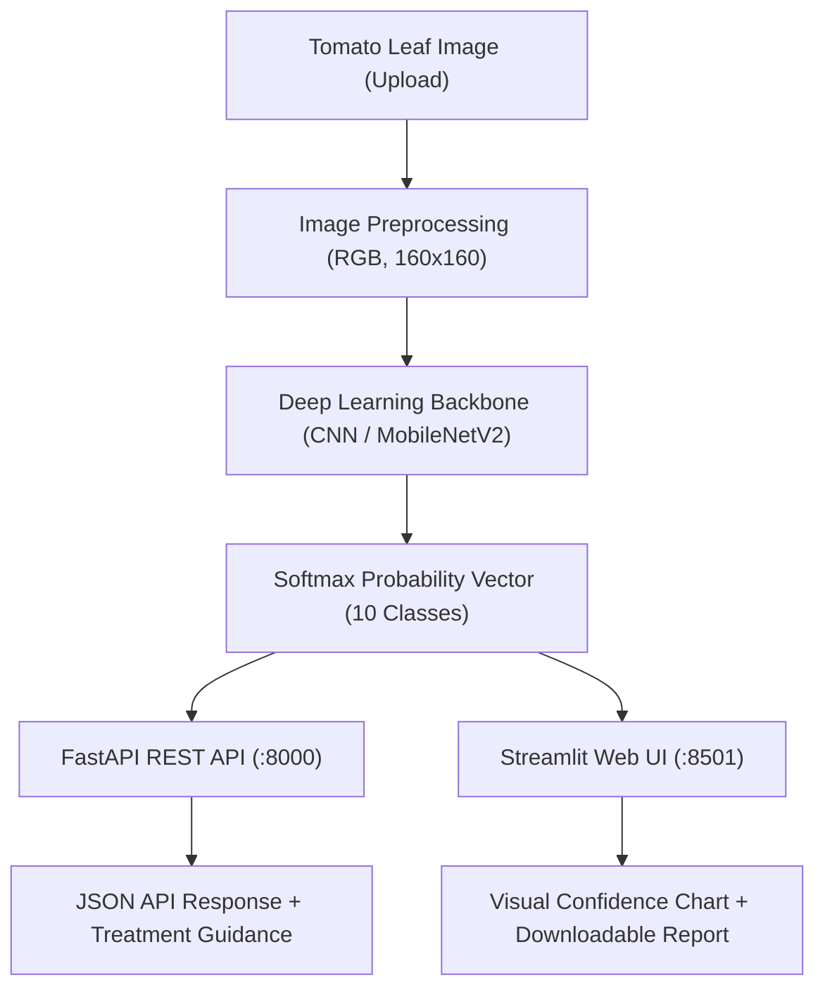

# 🍅 Tomato Plant Disease Classification & Decision Support System

[](https://www.python.org/)
[](https://www.tensorflow.org/)
[](https://fastapi.tiangolo.com/)
[](https://streamlit.io/)
[](https://www.docker.com/)
[](./tomato_cnn_outputs/validation_metrics.json)

An end-to-end deep learning system designed for automatic classification and diagnostic support of **10 tomato leaf conditions** (9 pathological infections and 1 healthy state). The project includes a high-performance **Convolutional Neural Network (CNN)**, a production-ready **FastAPI REST API**, an interactive **Streamlit Web Application**, and **Docker containerization** for seamless deployment.

---

## 📌 Table of Contents

- [Key Highlights](#-key-highlights)
- [Dataset & Disease Classes](#-dataset--disease-classes)
- [System Architecture](#-system-architecture)
- [Project Directory Structure](#-project-directory-structure)
- [Quick Start: Docker (Recommended)](#-quick-start-docker-recommended)
- [Local Installation & Setup](#-local-installation--setup)
- [Running the Services](#-running-the-services)
  - [1. FastAPI REST Backend](#1-fastapi-rest-backend)
  - [2. Streamlit Web Dashboard](#2-streamlit-web-dashboard)
  - [3. Jupyter Research Notebooks](#3-jupyter-research-notebooks)
- [REST API Documentation & Endpoints](#-rest-api-documentation--endpoints)
- [Testing & Quality Assurance](#-testing--quality-assurance)
- [Agricultural Disclaimer](#-agricultural-disclaimer)

---

## 🌟 Key Highlights

- **94.57% Validation Accuracy**: Trained and validated on over 22,900 images across 10 balanced categories.
- **CPU Optimized**: Lightweight 160×160 input resolution ensuring rapid, cost-effective inference without requiring dedicated GPU infrastructure.
- **Microservice Ready**: Production FastAPI backend equipped with OpenAPI/Swagger documentation, CORS, and Pydantic validation.
- **Farmer-Friendly UI**: Streamlit web dashboard providing instant predictions, confidence score breakdowns, and downloadable agronomic reports.
- **Containerized**: Multi-container Docker Compose configuration uniting backend API and frontend UI.
- **CI/CD Automated**: GitHub Actions workflow testing model integrity, unit tests, and Docker container builds.

---

## 🌿 Dataset & Disease Classes

The model classifies leaf images into 10 distinct categories:

| ID | Class Name | Common Name | Pathogen / Type | Symptoms Overview |
|:--:|:-----------|:------------|:----------------|:------------------|
| `0` | `Tomato___Bacterial_spot` | Bacterial Spot | *Xanthomonas spp.* | Small, water-soaked, dark greasy lesions |
| `1` | `Tomato___Early_blight` | Early Blight | *Alternaria solani* | Concentric target-like rings on lower leaves |
| `2` | `Tomato___Late_blight` | Late Blight | *Phytophthora infestans* | Rapid water-soaked dark lesions with pale halo |
| `3` | `Tomato___Leaf_Mold` | Leaf Mold | *Passalora fulva* | Olive-green velvety mold on leaf undersides |
| `4` | `Tomato___Septoria_leaf_spot` | Septoria Leaf Spot | *Septoria lycopersici* | Small circular spots with gray centers & dark rims |
| `5` | `Tomato___Spider_mites...` | Two-Spotted Spider Mites | *Tetranychus urticae* | Yellow stippling, leaf bronzing, fine silk webbing |
| `6` | `Tomato___Target_Spot` | Target Spot | *Corynespora cassiicola* | Dark brown concentric lesions causing defoliation |
| `7` | `Tomato___Tomato_Yellow_Leaf_Curl_Virus` | Yellow Leaf Curl (TYLCV) | *Begomovirus* (Whitefly) | Severe upward leaf curling, yellow margins, stunting |
| `8` | `Tomato___Tomato_mosaic_virus` | Mosaic Virus (ToMV) | *Tobamovirus* (Contact) | Mottled light/dark green mosaic, leaf distortion |
| `9` | `Tomato___healthy` | Healthy Leaf | N/A (Normal) | Uniform vibrant green foliage without lesions |

---

## 🏗 System Architecture



---

## 📁 Project Directory Structure

```text
Tomato Plant Diseases Augmented/
├── .github/
│   └── workflows/
│       └── ci.yml               # GitHub Actions CI pipeline (Tests & Docker Build)
├── api/
│   ├── __init__.py
│   ├── main.py                  # FastAPI application & endpoints
│   ├── model.py                 # Model loader & inference service
│   ├── schemas.py               # Pydantic request/response schemas
│   └── metadata.py              # Disease descriptions & treatment guidelines
├── tests/
│   ├── __init__.py
│   └── test_api.py              # Automated test suite (Pytest)
├── Tomato_Disease_Streamlit/
│   ├── app.py                   # Streamlit web dashboard
│   └── tomato_cnn_outputs/      # App-local model assets
├── tomato_cnn_outputs/
│   ├── tomato_disease_cnn_final.keras  # Trained final model
│   ├── tomato_cnn_best.keras           # Best checkpoint weights
│   ├── class_mapping.json              # Integer-to-class mapping
│   ├── validation_metrics.json         # Performance benchmarks
│   └── training_history.csv            # Epoch-by-epoch loss & accuracy
├── Dataset/                     # (Optional) Image dataset (train / valid)
├── Dockerfile                   # Production Dockerfile for FastAPI
├── Dockerfile.streamlit         # Production Dockerfile for Streamlit
├── docker-compose.yml           # Multi-container orchestration
├── requirements.txt             # Project dependencies
├── .gitignore                   # Git exclusions
├── .dockerignore                # Docker build exclusions
└── README.md                    # Project documentation
```

---

## 🐳 Quick Start: Docker (Recommended)

Run both the **FastAPI REST API** and the **Streamlit Web Dashboard** in isolated containers with a single command:

```bash
docker compose up --build
```

- **FastAPI Documentation**: [http://localhost:8000/docs](http://localhost:8000/docs)
- **Streamlit Web UI**: [http://localhost:8501](http://localhost:8501)

To stop the services:
```bash
docker compose down
```

---

## 💻 Local Installation & Setup

### 1. Prerequisites
- Python 3.12 (or 3.10+)
- Git

### 2. Clone Repository & Setup Virtual Environment
```bash
# Clone the repository
git clone https://github.com/your-username/tomato-plant-disease-cnn.git
cd tomato-plant-disease-cnn

# Create a virtual environment
python -m venv .venv

# Activate the virtual environment
# On Windows PowerShell:
.\.venv\Scripts\Activate.ps1
# On Linux / macOS:
source .venv/bin/activate

# Install dependencies
pip install --upgrade pip
pip install -r requirements.txt
```

---

## 🚀 Running the Services

### 1. FastAPI REST Backend
Start the high-performance ASGI server:
```bash
uvicorn api.main:app --host 0.0.0.0 --port 8000 --reload
```
- Interactive Swagger UI: [http://localhost:8000/docs](http://localhost:8000/docs)
- Alternative ReDoc UI: [http://localhost:8000/redoc](http://localhost:8000/redoc)

### 2. Streamlit Web Dashboard
Launch the web interface for disease diagnosis:
```bash
streamlit run Tomato_Disease_Streamlit/app.py
```
- Open browser at [http://localhost:8501](http://localhost:8501)
- Upload any tomato leaf image (`.jpg`, `.png`, `.bmp`) to view predictions and treatment recommendations.

### 3. Jupyter Research Notebooks
To explore dataset analysis, training pipelines, and evaluation metrics:
```bash
jupyter notebook Tomato_Disease_CNN_Research_Updated_160px_CPU.ipynb
```

---

## 📡 REST API Documentation & Endpoints

| Method | Endpoint | Description |
|:------:|:---------|:------------|
| `GET` | `/` | API status and directory of endpoints |
| `GET` | `/health` | Healthcheck (reports model loaded status) |
| `GET` | `/classes` | List of all 10 supported disease categories |
| `GET` | `/model-info` | Model architecture details and training benchmarks |
| `POST` | `/predict` | Upload an image file for instant disease classification |

### Example cURL Request (`/predict`)

```bash
curl -X POST "http://localhost:8000/predict" \
     -H "accept: application/json" \
     -H "Content-Type: multipart/form-data" \
     -F "file=@sample_leaf.jpg;type=image/jpeg"
```

### Example JSON Response

```json
{
  "predicted_class": "Tomato___Early_blight",
  "display_name": "Early Blight",
  "class_index": 1,
  "confidence": 0.9842,
  "confidence_percentage": "98.42%",
  "is_healthy": false,
  "scientific_agent": "Alternaria solani",
  "symptoms": "Concentric rings ('target-like' bullseye pattern) on older lower leaves, often surrounded by a yellow halo.",
  "treatment_recommendation": "Prune lower infected foliage and apply appropriate fungicides (such as chlorothalonil or copper). Maintain soil mulching to prevent soil spores from splashing onto foliage.",
  "inference_time_ms": 32.45,
  "all_probabilities": {
    "Tomato___Bacterial_spot": 0.0012,
    "Tomato___Early_blight": 0.9842,
    "Tomato___Late_blight": 0.0051,
    "Tomato___Leaf_Mold": 0.0003,
    "Tomato___Septoria_leaf_spot": 0.0028,
    "Tomato___Spider_mites Two-spotted_spider_mite": 0.0004,
    "Tomato___Target_Spot": 0.0035,
    "Tomato___Tomato_Yellow_Leaf_Curl_Virus": 0.0001,
    "Tomato___Tomato_mosaic_virus": 0.0001,
    "Tomato___healthy": 0.0023
  },
  "disclaimer": "This is an automated machine learning prediction for decision support, not an official diagnostic certificate."
}
```

---

## 🧪 Testing & Quality Assurance

Run the automated test suite using `pytest`:

```bash
pytest tests/ -v
```

Tests verify:
- Model loading and architecture initialization.
- Mapping and metadata integrity across all 10 classes.
- Full inference pipeline and latency tracking.
- Error handling for invalid/corrupted files.

---

## ⚠️ Agricultural Disclaimer

> [!IMPORTANT]
> This software is intended as an **experimental research prototype and educational decision-support tool**.
> Automated predictions should be corroborated with visual inspections and verified by qualified agricultural extension officers, agronomists, or plant pathologists before applying chemical interventions or crop destruction measures.

---

## 📄 License & Attribution

This project is open-source under the [Apache 2.0 License](LICENSE).
Built with ❤️ using TensorFlow, FastAPI, and Streamlit.

